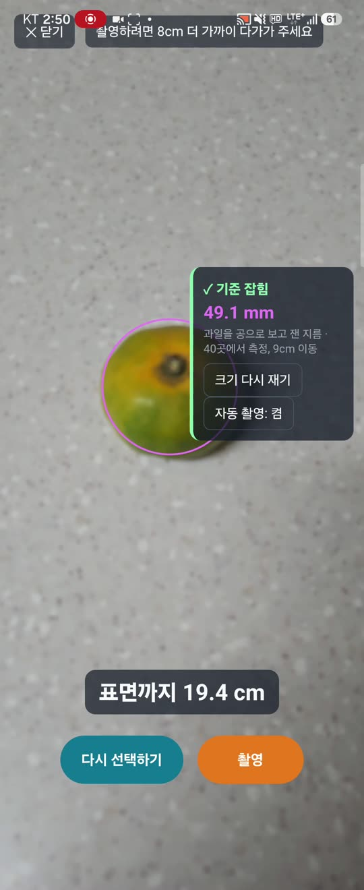
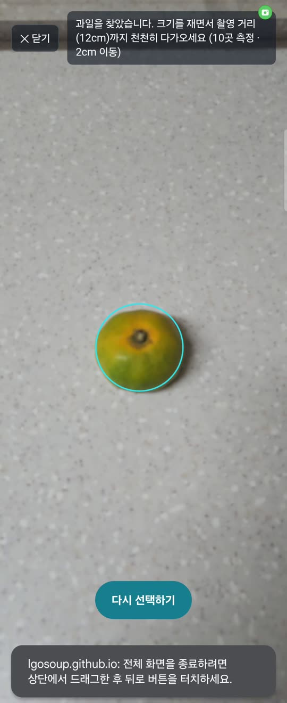
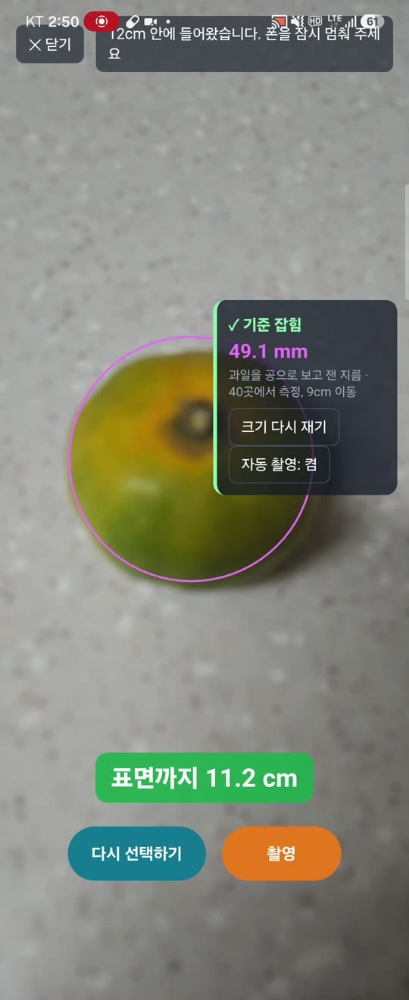
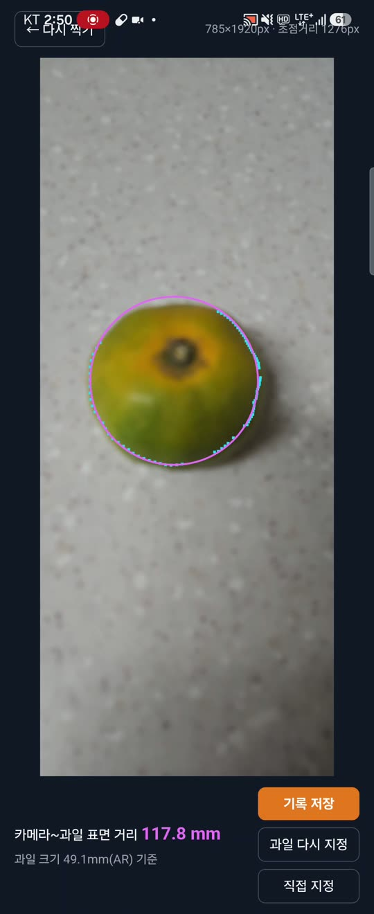
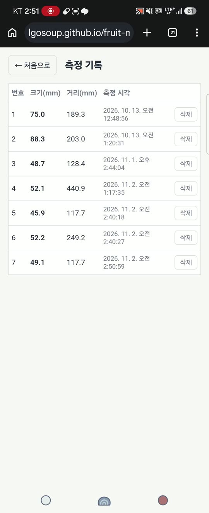
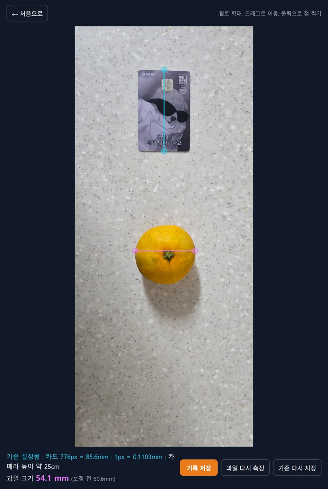
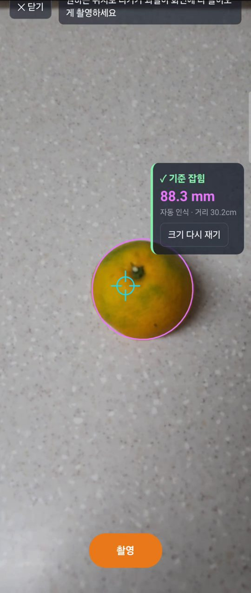
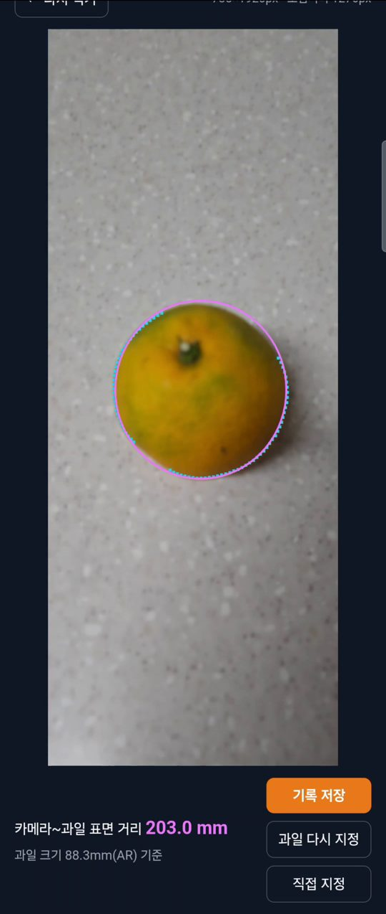

# fruit-measure

만감류(한라봉·천혜향 등)의 근적외선 당도 측정을 돕는 폰 웹앱입니다. 과일을 화면 가운데 두고 다가가기만 하면 앱이 과일을 찾아 따라가며 **크기(지름)**를 재고, 이어서 **카메라\~과일 표면 거리**를 실시간으로 보여 주며 측정 거리(12cm 이내)로 안내합니다. 12cm 안에서 폰을 잠시 멈추면 자동으로 촬영하고 그 순간의 거리를 기록합니다. 바이브 코딩(PRD → Todo → 테스트 → 스킬)으로 만들었습니다.

**바로 사용하기(갤럭시 Z 플립6 크롬): https://lgosoup.github.io/fruit-measure/**

## ▶ 실행 영상

> **이 앱은 안드로이드 폰의 AR(크롬 WebXR + ARCore)이 있어야 측정 화면이 열립니다.** PC 브라우저에서는 첫 화면에 「AR 미지원」 안내만 나오므로, 실제로 동작하는 모습은 아래 영상으로 확인해 주세요(갤럭시 Z 플립6 화면 녹화, 77초).

- **브라우저에서 바로 보기: [Google Drive에서 재생](https://drive.google.com/file/d/1u3tg0yqB6kL6-E2MwQpl4Bz4nIyHcQbS/view?usp=sharing)**
- **저장소의 영상 파일: [docs/demo.mp4](docs/demo.mp4)** (41MB, GitHub에서 「View raw」로 내려받아 재생)

<a href="https://drive.google.com/file/d/1u3tg0yqB6kL6-E2MwQpl4Bz4nIyHcQbS/view?usp=sharing"></a>

영상에는 같은 귤을 세 번 잰 모습이 담겨 있습니다(시간은 영상 기준).

**1회차: 자동 촬영까지 한 번에 (0:00–0:42)**

| 시간 | 화면 | 볼 점 |
|---|---|---|
| 0:00–0:02 | 첫 화면에서 「측정 시작」 → AR 시작, 「과일을 찾는 중입니다. 30cm쯤 떨어져 과일을 화면 가운데에 두세요」 | 버튼 없이 바로 과일 찾기가 시작됨 |
| 0:04–0:07 | 과일에 하늘색 원이 붙고 「크기를 재면서 촬영 거리(12cm)까지 천천히 다가오세요 (9곳 측정 · 8cm 이동)」 → 40곳 · 21cm | 다가가는 동안 측정 위치 수와 이동 거리가 늘어남 |
| 0:08 | 크기 확정: 화면 옆 「✓ 기준 잡힘 **100.5 mm**」, 원이 분홍색으로 바뀜 | **AR 위치 오류로 틀린 크기**(실제 약 50mm). 원은 과일에 맞게 붙어 있어 인식이 아니라 AR이 알려 준 폰 위치가 틀린 경우 |
| 0:08–0:21 | 「표면까지 ○○ cm」와 「촬영하려면 n cm 더 가까이」. 크기가 2배로 잡혀 거리도 실제보다 멀게 나오고, 가까이 가자 「너무 가깝습니다 … 조금 멀리」 | 크기가 틀리면 거리도 함께 틀림 → 다시 재야 하는 상황 |
| 0:23–0:25 | 「다시 선택하기」 → 「과일을 화면 가운데에 가깝게 해 주세요」, 하늘색 원으로 다시 찾음 | 잰 크기를 지우고 처음부터 다시 잼 |
| 0:26–0:27 | 39곳 · 9cm 이동 뒤 크기 **49.1 mm** 확정, 「표면까지 19.4 cm」, 「촬영하려면 8cm 더 가까이」 | 정상 크기 |
| 0:28–0:31 | 5cm → 2cm 더 가까이 → 12cm 안: 거리 표시가 **초록색**(11.2 cm), 「12cm 안에 들어왔습니다. 폰을 잠시 멈춰 주세요」 | 12cm 안에 들어와도 바로 찍지 않고 멈추기를 기다림 |
| 0:32 | **자동 촬영**: 폰을 멈추자 저절로 사진 화면으로 넘어감 | 촬영 버튼을 누르지 않음 |
| 0:32–0:39 | 사진 화면: 과일 윤곽(분홍)과 「카메라\~과일 표면 거리 **117.8 mm**」, 「과일 크기 49.1mm(AR) 기준」 | 촬영 순간의 거리가 12cm 안 |
| 0:40–0:42 | 「기록 저장」 → AR 화면으로 돌아와 「7번 기록 저장됨 · 크기 49.1mm · 거리 117.7mm. 다음 과일을 재세요」 | 저장 뒤 바로 다음 측정 |

**기록 확인 (0:43–0:46)**

| 시간 | 화면 | 볼 점 |
|---|---|---|
| 0:43–0:45 | 「닫기」 → 첫 화면 → 「기록 보기」: 측정 기록 목록(번호, 크기, 거리, 측정 시각) | 7번에 49.1mm · 117.7mm. 1·2번은 실습 과제 때 기록으로 그대로 남아 있음 |

**2회차: 흔들리면 찍지 않음 (0:47–1:00)**

| 시간 | 화면 | 볼 점 |
|---|---|---|
| 0:47–0:50 | 다시 「측정 시작」 → 찾는 중 → 하늘색 원, 10곳 · 2cm → 21곳 · 6cm | |
| 0:51 | 크기 **43.5 mm** 확정(29곳, 6cm 이동) | 실제보다 약 12% 작게 잡힘. 적게 움직여(6cm) 잰 경우 |
| 0:52–0:59 | 12cm 안 초록 표시와 「잠시 멈춰 주세요」가 떠도 손이 흔들려 찍히지 않음(「· 흔들림」). 너무 가까이 가자 「너무 가깝습니다 … 조금 멀리」 | 흔들리는 동안에는 자동 촬영하지 않음 |

**3회차: 크기 다시 재기, 직접 촬영, 직접 지정 (1:01–1:17)**

| 시간 | 화면 | 볼 점 |
|---|---|---|
| 1:01–1:02 | 「크기 다시 재기」 → 「과일을 찾았습니다 … (5곳 측정 · 0cm 이동)」 → 15곳 · 5cm | 따라가던 과일은 그대로 두고 크기만 다시 잼 |
| 1:03 | 크기 **51.2 mm** 확정(23곳, 7cm 이동) | 정상 크기 |
| 1:03–1:09 | 「표면까지 25.4 cm」 → 21.0 cm, 「촬영하려면 14cm → 9cm 더 가까이」 | |
| 1:10–1:11 | 「촬영」 버튼으로 **직접 촬영**(약 21cm) → 사진에서 거리 200.5 mm | 12cm 밖에서도 직접 찍을 수 있음 |
| 1:12–1:15 | 「직접 지정」 → 「과일 양 끝을 터치하세요 (0/2)」 → 양 끝 두 점 → 거리 **204.9 mm** | 윤곽 대신 사람이 양 끝을 지정해 잴 수 있음 |
| 1:16–1:17 | 「기록 저장」 → 「8번 기록 저장됨 · 크기 51.2mm · 거리 204.9mm」 | |

### 화면

<p>
  
  
  
  
  
</p>

왼쪽부터 과일 찾아 따라가기, 크기 확정과 실시간 거리, 12cm 안(초록), 자동 촬영된 사진의 거리, 기록 목록(실행 영상에서 잘라 냄).

---

## 목차

- [▶ 실행 영상](#-실행-영상) (PC에서는 AR이 열리지 않으므로 영상으로 확인)

1. [제작한 것 소개](#1-제작한-것-소개)
2. [실습 과제 시점과 비교](#2-실습-과제-시점과-비교)
3. [PRD와 Todo 리스트](#3-prd와-todo-리스트)
4. [Todo 리스트의 변경 내역](#4-todo-리스트의-변경-내역)
5. [스킬](#5-스킬)
6. [방법론의 장단점](#6-방법론의-장단점)
7. [개선이 필요한 점](#7-개선이-필요한-점)
8. [느낀 점, 결론](#8-느낀-점-결론)

---

## 1. 제작한 것 소개

### 왜 만들었나

이 앱은 캡스톤 프로젝트 「스마트폰 카메라 결합형 저비용 비파괴 당도 추정 기반 만감류 수확 적기 판정 보조기」에서 **측정 거리와 과일 크기**를 맡는 부분입니다.

- 캡스톤은 만감류에 근적외선을 비추고, 과일 속을 거쳐 돌아온 빛을 값싼 멀티스펙트럼 센서로 재서 자르지 않고 당도를 추정합니다.
- 시중 비파괴 당도계는 센서를 과일에 붙여 재지만, 캡스톤은 붙이지 않고 신호가 희석되지 않는 가까운 거리(최대 12cm)에서 잽니다. 그래서 **센서와 과일 사이 거리**가 측정값을 바꾸고, 측정한 순간의 거리를 함께 기록해 보정해야 합니다.
- **과일 크기**는 빛이 과육을 지나는 길이를 바꾸는 보정 값입니다. 당도를 직접 알려 주는 값이 아니므로 같은 방법으로 일관되게 잰 지름 하나면 됩니다.
- 지금은 캘리퍼스로 크기를, 자로 거리를 하나씩 재고 손으로 적어야 합니다. 이 앱은 폰 하나로 둘을 재고 기록합니다. **앱에서 촬영하는 순간이 근적외선을 비추고 재는 순간**에 해당합니다(센서 연동은 이후 캡스톤에서 합니다).

### 사용 방법

1. 과일을 테이블 위에 놓고 「측정 시작」을 누릅니다. 카메라 권한을 허용합니다.
2. 30cm쯤 떨어져 과일을 화면 가운데에 둡니다. 앱이 화면 가운데에 가장 가까운 과일을 찾아 둘레에 원을 그리고 따라갑니다. 다른 물체를 잡았으면 「다시 선택하기」를 누릅니다.
3. 과일 쪽으로 천천히 다가갑니다. 여러 위치에서 본 윤곽으로 크기가 정해지면 화면 옆에 완료 표시와 지름(mm)이 뜹니다.
4. 계속 다가가면 화면 아래에 「표면까지 ○○ cm」가 실시간으로 나오고 「촬영하려면 n cm 더 가까이」로 안내합니다. 12cm 안에 들어오면 초록색으로 바뀌고 진동으로 알립니다. 너무 가까워 과일이 화면에 다 안 들어오면 「조금 멀리」로 안내합니다.
5. 12cm 안에서 폰을 잠시(약 0.5\~1초) 멈추면 자동으로 촬영됩니다. 흔들리면 「폰을 잠시 멈춰 주세요」가 뜹니다. 「자동 촬영: 끔」으로 바꾸면 「촬영」 버튼으로 직접 찍습니다.
6. 찍은 사진에서 과일 윤곽과 카메라\~과일 표면 거리(mm)가 나옵니다. 윤곽이 틀리면 과일을 터치해 다시 찾거나 「직접 지정」으로 과일 양 끝을 터치합니다. 두 손가락으로 확대·이동할 수 있습니다.
7. 「기록 저장」을 누르면 다음 과일을 잴 수 있도록 AR 화면으로 돌아갑니다. 「기록 보기」에서 목록을 보고 삭제할 수 있습니다.

### 측정 원리

- **과일 찾기·따라가기**: 화면 가운데와 그 둘레 몇 곳에서 과일 윤곽을 찾아, 화면 가운데에 가장 가까운 것을 고릅니다(사용자에게 보이지 않는 기준점). 이후에는 직전 위치에서 다시 찾고, 크기나 위치가 갑자기 크게 바뀌면 다른 물체로 보고 버립니다. 위에서 내려다보면 화면 가운데가 꼭지라서, 찾은 윤곽을 감싸는 더 큰 윤곽이 있고 안쪽이 더 어두우면(꼭지) 바깥을 과일로 고릅니다.
- **윤곽 인식**: 가리킨 지점에서 120개 방향으로 선을 뻗어 과일 색과 달라지는 첫 지점(경계점)을 찾습니다. 과일은 구라서 윤곽을 지나는 시선은 모두 「카메라→과일 중심」 축과 같은 각도를 이룹니다(원뿔). 경계점을 이 원뿔에 맞추면서 맞지 않는 점은 버리므로, 윤곽 일부가 끊기거나 그림자·반사광이 있어도 둥근 윤곽을 찾습니다.
- **크기(다가가며)**: AR은 프레임마다 폰의 위치와 자세를 알려 줍니다. 여러 위치에서 본 윤곽 원뿔을 모아 하나의 구(중심, 반지름)에 최소제곱으로 맞추면 지름이 나옵니다. 폰이 5cm 이상 움직이고 3곳 이상에서 본 뒤, 최근 값 5개가 2% 안으로 모이면 크기를 확정합니다. 폰을 드는 각도나 테이블 높이를 가정하지 않습니다.
- **거리**: 크기를 알면 화면 속 윤곽 원뿔의 각도만으로 거리가 나옵니다. 원뿔 반각을 α라 하면 `중심까지 거리 = 반지름 / sin α`이고, 여기서 반지름을 빼면 표면까지 거리입니다. 근거리에서 흔히 쓰는 단순 비례식(초점거리 × 지름 ÷ 사진 속 지름)은 10cm에서 약 5% 짧게 나와 쓰지 않았습니다. 거리는 카메라 이미지와 크기만으로 구하므로, 가까이서 AR이 폰 위치를 놓쳐도 계속 나옵니다.
- **자동 촬영**: 12cm 안에 들어온 뒤의 거리 값 10개가 5mm 안쪽으로 모이면 「안정」으로 보고 그 순간을 찍습니다. 촬영한 사진에서는 AR에서 따라가던 원과 크기가 맞는 윤곽만 골라 거리를 다시 잽니다.

### 알아둘 점

- ARCore를 지원하는 안드로이드 크롬(갤럭시 Z 플립6에서 확인)에서만 동작합니다. PC에서는 첫 화면에 안내만 나오므로 동작은 [실행 영상](#-실행-영상)으로 확인합니다.
- 가까이 다가가면 카메라 화면이 흐려집니다. 웹(WebXR)에서는 AR 카메라 초점을 바꿀 수 없기 때문입니다(설치형 앱이면 가능). 윤곽으로 재는 거리·크기에는 영향이 없어 그대로 두었습니다.
- 크기는 AR이 알려 준 폰 위치로 계산하므로, AR이 위치를 잘못 잡으면(특히 시작 직후) 크기가 크게 틀릴 수 있습니다. [실행 영상](#-실행-영상) 앞부분(0:08)에서도 한 번 100.5mm(실제 약 50mm)가 나왔고, 「크기 다시 재기」로 다시 재 49.1mm를 얻었습니다. 크기가 이상하면 다시 잽니다.
- 아주 가까이 가서 과일을 놓치면 다시 잡지 못하고 계속 놓칠 수 있습니다. 조금 떨어지거나 「다시 선택하기」·「다시 찍기」로 다시 시작합니다.
- 기록은 사용하는 기기의 브라우저에만 저장됩니다. 서버나 계정이 없고, 브라우저의 사이트 데이터를 지우면 기록도 사라집니다. 실습 과제 때 카드 기준으로 잰 기록은 거리 칸이 「–」입니다.

### 기술

HTML, CSS, JavaScript와 WebXR(크롬이 ARCore로 AR 실행)을 사용했습니다. 빌드나 외부 라이브러리는 없고, GitHub Pages로 배포합니다.

| 파일 | 내용 |
|---|---|
| `measure.js` | 계산식: 원뿔 맞추기, 거리, 여러 위치 구 맞추기, 거리 안내, 안정 판정, 좌표 변환 |
| `detect.js` | 과일 윤곽 인식, 찾기·따라가기, 촬영 사진에서 과일 고르기 |
| `app.js` | 화면, AR, 촬영, 터치, 기록 |
| `test/measure.test.js` | 계산식 단위 테스트(26개) |
| `test/detect.test.js` | 계산으로 그린 과일 사진으로 윤곽 인식 테스트(31개) |
| `test/app-flow.test.js` | 가짜 AR 프레임으로 찾기 → 크기 → 거리 → 자동 촬영 → 저장 흐름 테스트(25개) |

테스트 실행: `node test/measure.test.js`, `node test/detect.test.js`, `node test/app-flow.test.js`

---

## 2. 실습 과제 시점과 비교

실습 과제(10/13 제출)는 같은 주제를 두 번에 나눠 만든 상태였습니다. **v1**은 신용카드와 함께 찍은 사진으로 PC에서 과일 크기를 재는 웹앱, **v2**는 폰 AR로 크기를 재고 가까이서 찍은 사진으로 거리를 재는 웹앱이었고, 저장소에 따로 있었습니다(`/`, `/v2/`).

<p>
  
  
  
</p>

실습 과제 시점 화면: 왼쪽부터 v1 카드 기준 크기 측정, v2 AR 과일 인식(버튼), v2 사진으로 거리 계산.

<p>
  
  
  
</p>

지금 화면: 다가가며 잰 크기와 실시간 거리, 12cm 안 안내, 자동 촬영된 사진의 거리. 카드 측정 화면은 AR 기준으로 대체되어 없습니다.

| 항목 | 실습 과제 시점 | 지금 | 바꾼 이유 |
|---|---|---|---|
| 앱 구성 | v1(PC)·v2(폰)가 따로, PRD·Todo도 두 벌 | 하나의 앱·하나의 PRD·Todo(1\~18단계) | 카드는 「사진의 크기 기준」을 잡는 수단이고 AR이 그 기준을 대신한 것이라, 한 측정 흐름으로 합침 |
| 크기 기준 | v1: 사진 속 신용카드, v2: AR | AR(카드 기준은 **대체**, [C-6](changes.md#c-6)) | 매번 카드를 놓는 것은 현장에서 비현실적 |
| 크기 재는 법 | 테이블을 인식한 뒤 조준점을 과일에 맞추고 「과일 인식」 또는 양 끝 「점 찍기」 | 과일을 화면 가운데 두고 **다가가기만** 하면 자동으로 찾아 따라가며 여러 위치에서 측정 | 폰에서 써 보니 버튼·각도 맞추기가 어려웠음([C-7](changes.md#c-7)) |
| 크기 결과 | 한 장면에서 잰 지름 | 여러 위치의 윤곽을 한 구에 맞춘 지름 | 테이블 높이·각도 가정 없이 크기가 정해짐 |
| 거리 | 사진을 찍은 **뒤에야** 나옴. 원하는 거리에 맞추려면 찍고 확인하기 반복 | 카메라 화면에 **실시간** 표시, 12cm 안으로 안내, 들어오면 초록·진동 | 근적외선 측정 거리를 맞추는 시간을 줄임([C-1](changes.md#c-1), [C-9](changes.md#c-9)) |
| 촬영 | 「촬영」 버튼 | 12cm 안에서 멈추면 **자동 촬영**(끌 수 있음), 그 순간의 거리 기록 | 촬영 = 근적외선 측정 순간, 손떨림 값 배제 |
| 촬영 사진의 윤곽 | 사진 가운데에서 찾음 | AR에서 따라가던 과일과 크기가 맞는 윤곽만 고름 | 위에서 찍으면 꼭지를 과일로 잡던 문제([C-13](changes.md#c-13)) |
| 테스트 | 계산식·윤곽 인식 단위 테스트, 가짜 WebXR 세션(저장소 밖) | + **AR 화면 흐름 테스트**(저장소 `test/app-flow.test.js`), 장면 생성 공용화(`test/scene.js`) | 폰 없이 찾기 → 크기 → 거리 → 자동 촬영 → 저장을 반복 확인 |
| 개발 방식 | PRD → Todo → 테스트 | + **변경 기록**(`changes.md`, todo·PRD 안 굵은 표시) + **스킬 4개**(`.claude/skills/`) | 바뀐 것을 처음 계획과 비교해 남기고, 반복 절차를 스킬로 묶음 |

기능은 줄이지 않았습니다. 사진에서 터치로 다시 인식·양 끝 직접 지정·확대·이동, 기록 저장·삭제는 그대로이고, 카드 기준 기록도 목록에 남아 있습니다. 실습 과제 v1에서 PC로 사진 파일을 불러와 마우스 휠로 확대하고 드래그로 옮기던 흐름은, 폰 앱 안에서 바로 촬영하고 두 손가락으로 확대·이동하는 흐름으로 대체했습니다.

---

## 3. PRD와 Todo 리스트

- **[PRD.md](PRD.md)**: 요구사항입니다. 목적(캡스톤 주제와 거리·크기가 필요한 이유) → 사용자·페르소나 → 핵심 기능 → 만들지 않는 것 → 디자인 → 기술 조건 → 가정 → 열린 질문 → 완성 기준 순서입니다. 처음 계획 뒤 바뀐 핵심 기능·만들지 않는 것·기술 조건·완성 기준에는 줄 끝에 변경 표시가 있습니다.
- **[todo.md](todo.md)**: 18단계입니다. 할 일마다 번호(`단계-순번`), 우선순위(P1\~P3), 근거 PRD 항목이 있고, 단계마다 목표와 짝이 되는 테스트([테스트], [회귀 테스트], [AI 검토], [폰])가 있습니다. 확인 방법은 대부분의 단계에 있습니다(실습 과제 때의 6·12단계 점검 단계에는 없음). 마지막 단계는 완성 기준 점검입니다.

| 단계 | 내용 | 시기 |
|---|---|---|
| 1\~6 | 신용카드 기준 PC 측정, 완성 기준 점검 | 실습 과제(원래 Todo) |
| 7\~13 | AR 기준 폰 측정, 사진 거리, 윤곽 자동 인식 | 실습 과제(원래 Todo) |
| 14 | 다가가며 크기 측정(자동 찾기·따라가기, 다시 선택하기) | 중간 과제 |
| 15 | 사진 거리와 기록에 회전타원체 반영 **(취소)** | 중간 과제 |
| 16 | 실시간 거리 표시와 12cm 안내 | 중간 과제 |
| 17 | 안정 판정과 자동 촬영 | 중간 과제 |
| 18 | 완성 기준 다시 점검(실측 비교 포함) | 중간 과제 |
| 추가 제안 | 개발용 스킬(PRD 근거가 없어 단계와 따로 둠) | 중간 과제 |

**진행 방식**: 「PRD 수정 → Todo 추가 → 구현 → 테스트 통과 → todo 체크 → 커밋·push → 폰 확인」을 단계마다 반복했습니다. 폰 확인에서 문제가 나오면 고치기 전에 todo에 `[버그 수정]` 항목과 변경 기록을 먼저 넣고, 그 문제를 재현하는 테스트가 고치기 전 코드에서 실패하는 것을 확인한 뒤 고쳤습니다. 커밋 메시지에는 todo 번호와 변경 번호(C-n)를 넣었습니다.

### 단계별 커밋

실습 과제(1\~13단계)

| 단계 | 내용 | 커밋 |
|---|---|---|
| 기획 | PRD·Todo | `990a734` `bf16d2f` |
| 1\~6 | 첫 화면, 사진 불러오기, 카드 기준, 과일 크기, 기록, 완성 점검 | `ad9b3f0` `f1797bb` `2143e76` `981f3a0` `5910b55` `34b4282` `529dfce` `9a3b0a7` `f8ad7fc` `7e564e4` |
| 7\~13 | AR 첫 화면, AR 촬영, AR 크기, 사진 거리, 기록, 점검, 윤곽 자동 인식 | `4b9d290` `ccf8786` `206c0a9` `6ee4c3d` `06975f5` `ac0c284` `056e580` |

7\~13단계 커밋 메시지는 「2차 todo 1-1」처럼 단계 번호에서 6을 뺀 번호로 적혀 있습니다.

중간 과제(10/29\~11/2)

| 단계 | 내용 | 커밋 |
|---|---|---|
| 준비 | v1·v2 통합, 저장소 정리 | `b8d3a45` `d90e073` |
| 기획 | PRD 업그레이드(실시간 거리·자동 촬영), todo 14\~18단계 계획 | `73ee752` `cb62dca` |
| 14 | 처음 설계(비스듬히 한 번에 가로·세로) 구현 → 폰 확인 뒤 「다가가며 자동 측정」으로 변경 | `dd8be40` `6c61caa` `c403c66` `0138932` `3a8995b` `6c44d5d` |
| 14 | 자동 찾기·따라가기·다가가며 크기, 폰 확인 뒤 버튼·안내 수정, 검토 | `03a33c3` `3c9123a` `bb1a74f` `0f9f47d` `03c96be` |
| 16 | 실시간 거리와 12cm 안내, 검토, 폰 확인, 한계 기록 | `6ce4a4f` `944fab9` `f3b24e0` `ae4dea7` |
| 17 | 자동 촬영, 검토, 폰 확인에서 나온 버그 2건(C-12, C-13)과 그 재현 중 찾은 1건(C-14) 수정, 완료 | `651e353` `4bbc725` `f3fa3ab` `ac6aad7` `109b989` `d40b57d` |
| 18 | 완성 기준 점검, 남은 폰 확인 | `22594a1` |
| 스킬 | 스킬 추가·보완 | `16ed924` `9dcd597` `3274277` `ce516ff` |

---

## 4. Todo 리스트의 변경 내역

원래 Todo는 **실습 과제를 마쳤을 때의 1\~13단계**입니다. 그 뒤에 바뀌거나 새로 넣은 것은 todo·PRD의 해당 줄 끝(새 단계는 단계 제목)에 굵게 표시했습니다.

```
- [x] 17-12. [P1] [버그 수정] 위에서 찍으면 사진에서 꼭지를 과일로 잡아 … (PRD #4-1, #4-3) **(추가 · 버그 / changes.md C-13)**
```

- 구분: **추가**(새 할 일, 버그 수정 포함) · **변경**(계획한 할 일이나 PRD 내용을 고침) · **취소**(하지 않기로 함, todo에서 지우지 않고 취소선으로 남김)
- 요약: 버그 · 테스트 중 발견 · 생각 못 한 구현 문제 · 새 아이디어 · 범위 조정 · 계획 누락
- 표시의 `C-n`은 [changes.md](changes.md)의 항목으로 연결됩니다. 거기에 원래 내용 → 바뀐 내용, 이유, 시행착오, 날짜·커밋이 있습니다.

### 처음 계획과 비교

**새로 넣은 기능**

| 번호 | 내용 | 계기 |
|---|---|---|
| [C-1](changes.md#c-1) | 실시간 거리 안내와 자동 안정 판정(16·17단계) | 새 아이디어: 찍어야만 거리가 나와 거리 맞추기를 반복해야 했음 |
| [C-2](changes.md#c-2) | 과일을 회전타원체로 보고 가로·세로 두 크기 측정(14·15단계). 이후 [C-7](changes.md#c-7)에서 다가가며 재는 방식으로, [C-8](changes.md#c-8)에서 지름 하나로 바뀜 | 새 아이디어 |

**기능을 수정한 것**

| 번호 | 처음 계획 → 바뀐 것 | 계기 |
|---|---|---|
| [C-6](changes.md#c-6) | 카드 기준 크기 측정 → AR 기준으로 **대체**(카드 기록은 목록에 남음) | 범위 조정: 기준 물체를 매번 놓는 것은 비현실적 |
| [C-7](changes.md#c-7) | 비스듬히 들고 한 번에 재기 → 과일을 화면 가운데 두고 다가가면 자동으로 찾아 따라가며 재기, 「다시 선택하기」 | **테스트 중 발견**: 단위 테스트는 오차 1% 안쪽이었지만 폰에서 30\~60° 각도 맞추기가 어려웠음 |
| [C-8](changes.md#c-8) | 가로·세로 두 크기 → 구로 본 지름 하나 | 범위 조정: 크기는 보정 값이라 일관된 지름 하나면 충분 |
| [C-9](changes.md#c-9) | 10cm 고정 → 12cm 이내, 촬영 = 근적외선 측정 순간 | 범위 조정: 정확히 한 값이 아니라 한도 안이면 되고, 그 순간 거리를 기록 |

**테스트 후에 생긴 변화(버그 수정)**

| 번호 | 증상 → 고친 것 | 발견 |
|---|---|---|
| [C-10](changes.md#c-10) | 크롬 기본 안내가 아래쪽 버튼을 가림, 시작하자마자 「놓쳤습니다」 → 버튼 위치·시작 안내 정리 | 폰 확인(14-22) |
| [C-12](changes.md#c-12) | 12cm에 들어오자마자 자동 촬영됨 → 들어온 뒤의 값으로만 판정, 판정 시간 늘림. 안내에 「촬영 거리(12cm)까지」 목적 추가 | 폰 확인(17-8) |
| [C-13](changes.md#c-13) | 위에서 찍으면 사진에서 꼭지를 과일로 잡아 거리 440.9mm(실제 약 10cm) → 따라가던 원과 크기가 맞는 윤곽만 고름 | 폰 확인(17-8) |
| [C-14](changes.md#c-14) | 위에서 시작하면 처음 찾기에서도 꼭지를 잡아 크기 22.2mm(실제 70mm) → 감싸는 더 큰 윤곽이 있고 안쪽이 어두우면 바깥을 고름 | C-13 재현 장면을 다른 단계에 돌려 발견 |

**뺀 것**

| 번호 | 내용 | 이유 |
|---|---|---|
| [C-3](changes.md#c-3) | 카메라로 과일 색 측정, 과일 옆 기준 물체 → 만들지 않는 것에 추가 | 색은 센서가 통제된 광원으로 재고, 기준 물체는 현장에서 비현실적 |
| [C-8](changes.md#c-8) | 15단계(사진 거리·기록에 회전타원체 반영) 전체 취소 | 크기를 지름 하나로 정해 필요 없어짐 |
| [C-7](changes.md#c-7) | 14-3·14-4(가로·세로 직접 지정 등), 점 찍기·과일 인식 버튼 | 다가가며 자동 측정으로 바뀜 |

**계획에서 빠졌던 것(개발 도구)**

| 번호 | 내용 |
|---|---|
| [C-4](changes.md#c-4) | 14단계 PC 흐름 테스트(14-10) |
| [C-5](changes.md#c-5), [C-11](changes.md#c-11) | 개발용 스킬 4개(todo 「추가 제안」 제안-1\~7) |

---

## 5. 스킬

스킬은 `.claude/skills/`에 있고, 모두 이 프로젝트를 하면서 **직접 만든 스킬**입니다. 14단계를 한 번 해 본 뒤 반복되는 절차와 규칙을 골라 만들었고(제안-1\~5), 17단계 전에 [AI 검토] 절차를 하나 더 묶었습니다(제안-6\~7). 앱 기능이 아니라 PRD 근거가 없으므로, todo의 「추가 제안」 칸에 따로 두었습니다.

| 스킬 | 하는 일 | 만든 이유 |
|---|---|---|
| `stage-wrapup` | 단계 마무리: 테스트 → todo 체크 → 변경 표시 → 표시 검사 스크립트 → 커밋·push → 보고 | 단계마다 같은 절차를 반복했고, 변경 표시 규칙(형식, 번호, 링크)을 사람이 기억하면 빠뜨림 |
| `submission-review` | GitHub에 올라간 것만 보고 제출 요건을 평가자 시점으로 판정 | 만든 사람은 맥락을 알아서 빠진 기록을 못 봄. 단계마다·마감 전에 같은 기준으로 검토 |
| `fruit-test-scene` | 정답을 계산식과 따로 만든 과일 장면으로 계산식 테스트, 좌표 규칙 | 이 프로젝트 고유 지식. 좌표 규칙 하나만 틀려도 그럴듯하게 틀리고, 계산이 바뀌는 단계마다 같은 방식이 필요 |
| `pages-preview` | push 뒤 배포 반영 확인, PC 크롬에서 배포 페이지에 가짜 AR 프레임을 넣어 화면 검토 | [AI 검토]마다 배포 기다리기·파일 비교·가짜 AR 코드 작성을 똑같이 반복함 |

### stage-wrapup

- **쓰인 곳**: 14단계 이후 모든 단계 마무리. 평가자 시점 검토(submission-review) 결과를 반영할 때(`9dcd597`) 처음 정식으로 불러 순서대로 진행했고, 문서 점검(`0138932`), 14·16·17·18단계 커밋(`03a33c3`, `6ce4a4f`, `651e353`, `f3fa3ab`, `ac6aad7`, `109b989`, `22594a1` 등)마다 표시 검사 스크립트(`scripts/check-marks.js`)로 C-1\~C-14의 형식·링크·커밋 번호를 확인했습니다. 폰 확인에서 버그가 나오면 「먼저 todo에 [버그 수정]과 C-n을 넣고 고친다」는 규칙대로 C-10, C-12\~C-14를 처리했습니다.
- **만든 이유**: 14단계를 해 보니 마무리 절차가 매번 같았고, 변경 표시(굵게, C-번호 링크, 요약 말)를 손으로 맞추다 빠뜨리는 일이 생겼습니다. 검사 스크립트로 규칙 위반을 기계적으로 잡게 했습니다(제안-4에서 틀린 표시를 잡아내는지 확인).

<details>
<summary>SKILL.md 원문</summary>

[`.claude/skills/stage-wrapup/SKILL.md`](.claude/skills/stage-wrapup/SKILL.md)

````markdown
---
name: stage-wrapup
description: fruit-measure의 todo 한 단계(또는 할 일 묶음)를 끝낼 때 테스트 확인, todo 체크, 변경 표시(changes.md) 기록, 표시 검사, 커밋·push, 사용자 보고를 정해진 순서로 처리한다. "단계 마무리", "커밋해", "todo 체크", 계획에 없던 할 일·버그를 todo에 넣을 때 사용한다.
metadata:
  project: fruit-measure
---

# 단계 마무리

todo의 단계는 「구현 → 테스트 통과 → 체크 → 커밋·push → 사용자 확인 → 다음 단계」로 진행한다. 이 스킬은 구현이 끝난 뒤부터 사용자 확인을 받기까지를 맡는다. 완료의 기준은 코드를 다 쓴 것이 아니라 **테스트를 통과한 것**이다.

## 순서

1. **테스트 실행**: 저장소 맨 위에서 아래 세 명령이 모두 「모두 통과」로 끝나야 한다(계산식, 윤곽 인식, AR 화면 흐름).
   ```
   node test/measure.test.js
   node test/detect.test.js
   node test/app-flow.test.js
   ```
   - 실패하면 고친 뒤 다시 실행한다. 원인이 이번 단계 밖에 있으면 고치기 전에 todo에 `[버그 수정]` 항목을 추가한다(3번).
   - 새 계산식의 테스트를 쓰거나 결과가 너무 쉽게 통과하면 `fruit-test-scene` 스킬을 따른다.
2. **todo 체크**: 테스트로 확인한 할 일만 `[ ]` → `[x]`로 바꾼다.
   - `[폰]` 항목은 사용자가 폰에서 확인하므로 체크하지 않는다.
   - 할 수 없었거나 일부만 한 항목은 체크하지 않고, 보고할 때 이유를 말한다.
3. **변경 표시**: 처음 계획 뒤에 todo나 PRD가 바뀌었으면 표시한다(아래 「변경 표시 규칙」).
4. **표시 검사**: `scripts/check-marks.js`를 실행해 문제가 없을 때까지 고친다. 저장소 맨 위에서 실행한다.
   ```
   node .claude/skills/stage-wrapup/scripts/check-marks.js
   ```
   - 검사하는 것: 표시 형식과 굵게 쓰기, 구분·요약 말, C-번호와 링크, changes.md 목록과 상세의 짝, 이유·커밋 번호 빈칸, 취소선
   - 커밋 전에는 이번에 새로 쓴 changes.md 항목의 「커밋 번호가 비어 있음」만 남아도 된다. 커밋한 뒤 6번에서 채운다.
5. **커밋·push**: 「커밋 메시지」 형식으로 커밋하고 push한다. 사용자가 커밋을 맡겼을 때만 한다.
6. **커밋 번호 기록**: 이번 커밋에 들어간 changes.md 항목의 「날짜 / 커밋」에 커밋 번호(앞 7자리)를 적는다. 이 수정은 다음 커밋에 함께 넣는다.
7. **보고**: 사용자에게 아래를 알린다. 사용자가 확인하기 전에는 다음 단계를 시작하지 않는다.
   - 끝낸 할 일 번호(예: 「14-1~14-7 완료」)와 각각 무엇을 했는지
   - 테스트 결과(통과 개수, 실제 오차처럼 숫자로 확인한 것)
   - 체크하지 않은 항목과 이유
   - `[폰]` 항목: 무엇을, 어떤 순서로, 무엇과 비교해 확인할지. 「앱을 새로고침한 뒤」 시작해 달라고 함께 적는다(배포 파일이 10분 캐시됨)
   - `[AI 검토]` 항목은 `pages-preview` 스킬로 배포 페이지를 직접 열어 확인한다

## 변경 표시 규칙

처음 계획한 todo·PRD에서 바뀐 것은 바뀐 줄 끝에 표시하고, 자세한 내용은 `changes.md`에 번호(`C-n`)를 붙여 한 곳에 모은다.

- **원래 Todo**는 실습 과제를 마쳤을 때의 1~13단계다. 그 뒤에 바뀐 것만 표시한다.
- **표시 형식**: `**(구분 · 요약 / [changes.md C-n](changes.md#c-n))**` — 다른 괄호(PRD 근거 등)와 구분되도록 굵게 쓴다
  - todo 할 일은 PRD 근거 괄호 뒤, 줄 맨 끝에 붙인다.
  - 새로 붙인 단계는 단계 제목에 한 번만 붙인다. 그 단계 안에서 생긴 버그·변경은 항목마다 따로 붙인다.
  - 한 변경이 여러 줄에 걸치면 같은 C-번호를 가리킨다.
- **구분**: `추가`(새 할 일, 버그 수정 포함) · `변경`(계획한 할 일이나 PRD 내용을 고침) · `취소`(하지 않기로 함. 지우지 않고 `~~취소선~~`으로 남김)
- **요약**: changes.md 맨 위 「요약에 쓰는 말」에서 고른다. 맞는 말이 없으면 목록에 먼저 추가한다.
- **표시하지 않는 것**
  - 이전 단계에서 못 끝낸 항목을 이번에 끝내는 것(진행일 뿐이다. 내용을 고쳐서 하면 `변경`)
  - PRD의 문구 다듬기·세부 보충. PRD는 핵심 기능(4번), 만들지 않는 것(5번), 기술 조건의 방향(7번), 완성 기준(10번)이 바뀔 때만 표시한다.
- **changes.md 기록**: 목록 표에 한 줄(`| [C-n](#c-n) | 구분 | 요약 | 대상 |`)을 넣고, 아래 상세에 `assets/change-entry.md` 양식으로 항목을 쓴다. 시행착오(처음 시도한 방법과 버린 이유)는 짧게라도 남긴다.
- **PRD 근거가 없는 할 일**(개발 도구 등)은 todo의 「추가 제안」 칸에 `제안-n` 번호로 넣는다.

## 커밋 메시지

```
종류: 무엇을 했는지 (todo 번호)

왜 했는지 1~3문장.

- 무엇을 바꿨는지 항목별로 (해당 todo 번호)
- 테스트 결과

Co-Authored-By: (함께 작업한 AI)
```

- 종류: `feat`(기능) · `fix`(버그 수정) · `docs`(문서) · `test`(테스트만) · `chore`(정리)
- 제목만 읽어도 무엇을 했는지 알 수 있게 쓴다. 「수정」, 「업데이트」만 쓰지 않는다.
- todo 번호는 범위로 쓴다: `(todo 14-1~14-7)`, `(todo 제안-1)`

[예시]
```
docs: 폰 테스트에서 발견한 사용성 문제로 크기 측정을 「다가가며 자동 측정」으로 변경 (todo 14-8, 14-9, C-7)

폰에서 써 보니 30~60°로 비스듬히 들기 어렵고, 각도가 틀려도 안내가
없었다. 과일이 보이는 크기는 거리에 반비례하므로, 폰의 이동 거리와
과일이 커지는 정도를 합치면 각도 가정 없이 크기가 정해진다.

- PRD: 핵심 기능·기술 조건·완성 기준을 새 측정 흐름으로 바꿈
- todo 14단계: 14-3·14-4 취소, 14-9 폰 결과 기록, 14-11~14-22 추가
- changes.md에 C-7 추가
```

## 자주 나오는 경우

- **테스트 중 버그 발견**: 바로 고치지 말고 먼저 todo에 `- [ ] n-m. [P?] [버그 수정] 증상 (PRD #근거) **(추가 · 버그 / C-n)**`을 넣고 changes.md에 기록한 뒤 고친다.
- **계획한 테스트 방법을 쓸 수 없음**(예: 브라우저를 열 수 없음): 다른 방법으로 확인했으면 그 사실을 보고하고, 계획과 달라진 점은 `변경`으로 표시한다. 확인하지 못했으면 체크하지 않는다.
- **단계가 길어짐**: 중간에 한 번 더 커밋·push해도 된다. 여러 단계를 한 커밋에 몰지는 않는다.
- **`[폰]` 확인에서 문제가 나옴**: 사용자가 알려준 증상을 `[버그 수정]` 항목으로 추가하고, 같은 단계 안에서 고친다.
  - 화면 위치(위·아래, 어느 버튼)처럼 해석이 갈리는 지적은 고치기 전에 어느 요소인지 확인한다. 짐작으로 고쳤다가 반대쪽을 고친 적이 있다.
  - 「고쳤는데 그대로」라고 하면 먼저 배포 파일이 커밋과 같은지 보고, 같으면 폰 캐시(새로고침)를 의심한다.
````

</details>

### submission-review

- **쓰인 곳**: 14단계 뒤 교수 역할의 별도 검토자가 이 스킬로 GitHub만 보고 검토했습니다(제안-5). 「카드 기준 화면이 기록 없이 사라져 기능 축소로 보일 수 있다」, 「원래 Todo 범위가 없고 변경 표시가 다른 괄호와 구분되지 않는다」를 지적해, 카드를 AR 기준 **대체**로 기록하고(C-6) 표시를 굵게 바꿨습니다(`9dcd597`). 17단계 전 중간 점검에서도 불러 README 사용법이 이미 틀린 것을 확인했습니다(README는 마지막에 정리).
- **만든 이유**: 평가는 README·커밋·결과물만으로 하는데, 만든 사람은 대화로 아는 맥락 때문에 문서에 빠진 것을 보지 못합니다. 평가자 시점의 기준을 스킬로 고정해, 누가 언제 검토해도 같은 항목을 보게 했습니다.

<details>
<summary>SKILL.md 원문</summary>

[`.claude/skills/submission-review/SKILL.md`](.claude/skills/submission-review/SKILL.md)

````markdown
---
name: submission-review
description: fruit-measure 저장소를 평가자 입장에서 GitHub에 올라간 것만 보고 검토해, 제출 요건(README 항목, PRD·Todo, Todo 변경 표시, SKILL.md, 커밋 기록, 실행 가능 여부)을 충족했는지 판정하고 고칠 점을 보고한다. "제출 검토", "평가자 시점으로 확인", 단계를 마칠 때의 가벼운 점검, 마감 전 최종 점검에 사용한다.
metadata:
  project: fruit-measure
  repository: https://github.com/lgosoup/fruit-measure
---

# 제출 검토

평가자는 **GitHub에 올라간 것만** 본다: README, 커밋 기록, 결과물(코드, 배포 페이지, 영상). 로컬에만 있는 파일, 아직 push하지 않은 커밋, 대화 내용은 없는 것으로 친다. 검토자는 만든 사람의 설명을 믿지 말고 저장소에서 근거를 직접 찾는다.

## 확인 방법

- 저장소: https://github.com/lgosoup/fruit-measure (기본 브랜치 `main`)
- 파일: `https://raw.githubusercontent.com/lgosoup/fruit-measure/main/<경로>`
- 커밋 기록: `gh api repos/lgosoup/fruit-measure/commits?per_page=100` 또는 GitHub 커밋 화면
- 배포 페이지: https://lgosoup.github.io/fruit-measure/
- 로컬 작업 폴더가 있어도 읽지 않는다. push된 상태만 판단한다.

## 점검 항목

### 1. 저장소
- [ ] Public이고 로그인 없이 열린다.
- [ ] 비밀 값(API 키, 비밀번호)이 커밋되어 있지 않다.
- [ ] 작업용 메모, 강의 자료, 개인 문서처럼 결과물이 아닌 파일이 올라가 있지 않다.

### 2. README (평가의 중심)
- [ ] **프로젝트 소개**: 무엇을, 왜 만들었는지, 사용 방법.
- [ ] **이전 버전과 비교**: 이어서 발전시킨 과제라면, 이전 제출 시점과 비교해 무엇이 달라졌는지(기능 추가·개선, 구조 변경, 바꾼 이유)가 드러난다.
- [ ] **PRD와 Todo**: `PRD.md`, `todo.md`로 연결되고 구성이 요약되어 있다.
- [ ] **Todo 변경 내역**: 기능을 수정한 것, 테스트 후에 생긴 변화, 빼거나 새로 넣은 항목을 **처음 계획과 비교해** README에서 알 수 있다. todo 안에서도 원래 없던 항목임이 눈에 띄게 표시되어 있다. 변경이 하나도 없으면 부족으로 본다.
- [ ] **스킬**: `SKILL.md`가 1개 이상 있고, README에 스킬마다 ① SKILL.md 내용 ② 작업에서 실제로 어떻게 쓰였는지(어느 단계·커밋) ③ 직접 만들었으면 만든 이유, 기존 스킬이면 고른 이유가 있다.
- [ ] **느낀 점, 결론**: 실제로 겪은 사례에 근거한다.
- [ ] 문서가 그 자체로 읽힌다: 저장소에 없는 문서나 비공개 자료를 가리키지 않는다.

### 3. PRD·Todo 형식
- [ ] PRD에 목적, 사용자, 핵심 기능, 만들지 않는 것(비어 있지 않음), 기술 조건, 완성 기준이 있다.
- [ ] Todo 할 일마다 번호(`단계-순번`), PRD 근거, 우선순위가 있고, 단계마다 목표와 확인 방법이 있다.
- [ ] 기능 할 일마다 짝이 되는 테스트 할 일이 있다.
- [ ] 마지막 단계가 완성 기준 점검이다.
- [ ] 변경 표시가 `changes.md`의 항목으로 연결되고, 링크가 깨지지 않는다.

### 4. 커밋 기록
- [ ] 한 번에 몰아서 올리지 않고 Todo를 따라 일정한 간격(여러 날)으로 커밋·push했다.
- [ ] 커밋 메시지마다 무엇을 했는지 분명하다(「수정」, 「업데이트」 같은 메시지가 없다). Todo 번호가 있어 todo.md와 맞춰 볼 수 있다.
- [ ] todo에서 체크한 단계마다 대응하는 커밋이 있다.
- [ ] 마감 시각이 주어졌으면, 그 뒤의 커밋은 평가에서 빠진다고 보고 판단한다.

### 5. 실행
- [ ] 배포 페이지가 열린다(응답 200, 스크립트 오류 없음).
- [ ] 이전보다 기능이 줄지 않았다(README·PRD의 기능이 그대로 있다).
- [ ] 이 앱은 안드로이드 폰의 AR이 필요해 PC 브라우저에서는 측정할 수 없다. 그래서 **실행 모습을 찍은 영상을 README에서 찾을 수 있어야 한다**(저장소 파일 또는 링크). README에 폰이 필요한 이유가 적혀 있어야 한다.

## 보고 형식

```
## 제출 검토 결과 (검토 시각, 기준 커밋)

| 항목 | 판정 | 근거 | 고칠 점 |
|---|---|---|---|
| README 소개 | 충족 / 부족 / 없음 / 확인 불가 | 파일·줄·커밋 번호 | 구체적으로 |

### 꼭 고쳐야 할 것 (평가에 직접 영향)
### 고치면 좋은 것
### 아직 진행 중이라 판단을 미룬 것
```

- 판정마다 근거(파일 경로, 커밋 번호, URL)를 붙인다. 근거를 찾지 못하면 「확인 불가」로 쓴다. 충족으로 추측하지 않는다.
- 진행 중인 저장소를 검토할 때는 「아직 안 한 것」과 「잘못한 것」을 나눠 쓴다. 마감 전 최종 점검에서는 둘 다 부족으로 본다.

## 자주 나오는 경우

- **이전에 있던 화면이나 기능이 없어짐**: 기능 축소로 보일 수 있다. 변경 기록(changes.md)과 README에 무엇으로 대체됐는지와 그 이유가 있으면 「대체」로 보고, 기록이 없으면 「꼭 고칠 것」으로 올린다.
- **테스트를 실행할 수 없음**(권한, 실행 환경): 실행하지 못했다고 쓰고 「확인 불가」로 둔다. 코드를 읽고 통과할 것이라고 추측하지 않는다.
- **README의 사실이 문서와 다름**(단계 수, 사용 방법 등): 마지막에 쓸 절과 달리 이미 틀린 내용이므로 「꼭 고칠 것」으로 올린다.
- **한 커밋에 성격이 다른 일이 섞임**: 「고치면 좋은 것」으로 올린다.
````

</details>

### fruit-test-scene

- **쓰인 곳**: 여러 위치 구 맞추기(14-15·14-17, `03a33c3`)에서 처음 정식으로 불러, 통과한 뒤 실제 오차를 찍어 보고 「납작한 과일은 보는 각도에 따라 지름이 최대 약 6% 달라짐」, 「7cm 움직이면 1% 이내」를 확인해 허용 오차를 근거 있게 정했습니다. 이때 만든 장면 함수를 `test/scene.js`로 모아 AR 흐름 테스트도 같이 쓰게 했습니다. 17단계에서는 꼭지 문제를 위에서 본 장면으로 재현해(고치기 전 코드에서 270.8mm·22.2mm로 실패 확인) C-13·C-14를 고쳤습니다.
- **만든 이유**: 계산식은 폰 없이 검증해야 하는데, 정답을 계산식과 같은 식으로 만들면 같은 실수를 해도 함께 맞아 버립니다. 정답을 독립적으로 만드는 방법, 장면 옵션, 허용 오차 기준, 좌표 규칙은 이 프로젝트에만 있는 지식이라 스킬로 남겼습니다.

<details>
<summary>SKILL.md 원문</summary>

[`.claude/skills/fruit-test-scene/SKILL.md`](.claude/skills/fruit-test-scene/SKILL.md)

````markdown
---
name: fruit-test-scene
description: fruit-measure의 계산식(크기·거리·윤곽 인식)을 바꾸거나 새로 만들 때, 정답을 계산식과 독립적으로 만든 과일 장면(정확한 윤곽 시선, 계산으로 그린 카메라 사진)으로 단위 테스트를 쓰고, 통과해도 실제 오차와 구분 가능성을 숫자로 확인한다. measure.js·detect.js를 고치거나 test/*.test.js에 테스트를 추가할 때 사용한다.
metadata:
  project: fruit-measure
---

# 과일 장면으로 계산식 테스트하기

계산식은 폰 없이 검증해야 한다. 그래서 정답을 알고 있는 가짜 과일 장면을 만들고, 계산식이 그 정답을 다시 찾아내는지 본다. 좌표 규칙을 하나만 틀려도 결과가 그럴듯하게 틀리므로, 좌표를 다루기 전에 `references/coordinates.md`를 읽는다.

## 순서

1. **무엇을 확인할지 정한다**: 입력(윤곽 시선 또는 사진), 출력(가로·세로·거리), 허용 오차.
2. **정답을 독립적으로 만든다**: 테스트할 계산식과 같은 식으로 정답을 만들지 않는다(같은 실수를 하면 함께 맞아 버린다).
   - 윤곽 시선: 시선이 과일에 닿는지를 이차방정식으로 판정하고, 닿음과 안 닿음이 바뀌는 각도를 이분법으로 찾는다(`test/measure.test.js`의 `spheroidSilhouette`).
   - 사진: 화소마다 시선을 쏘아 과일·테이블과 만나는 점의 색을 칠한다(`test/scene.js`의 `render`).
   - 거리 정답: 카메라에서 과일 중심을 향한 선이 표면과 만나는 점까지(`trueSpheroidDistanceMm`).
3. **기본 장면부터 어려운 장면까지 넣는다**(아래 「장면 옵션」).
4. **실행한다**: `node test/measure.test.js`, `node test/detect.test.js`, `node test/app-flow.test.js`
5. **통과해도 숫자를 본다**: 처음부터 전부 통과하면 테스트가 너무 쉬울 수 있다.
   - 실제 오차(측정값/정답)를 한 번 찍어 허용 오차보다 충분히 작은지 확인한다.
   - 값이 정말 구분되는지 확인한다. 예: 비율을 틀리게 넣었을 때의 맞춤 오차가 화소 1개의 각도(약 1/fx 라디안)보다 커야 그 비율을 사진에서 찾을 수 있다. 작으면 그 조건(각도·거리)은 앱에서 막거나 안내한다.
   - 확인용 출력은 테스트에 남기지 않는다.
6. **실패 조건도 테스트한다**: 계산하면 안 되는 입력이 `null`이나 오류(`none`, `cut`, `small`)로 끝나는지 본다.

## 예시

[예시] 「AR에서 지름 70mm 과일을 45도로 보면 크기와 거리가 3% 안에서 다시 나온다」를 확인하는 테스트

```js
test("AR 45도: 크기·거리 3% 이내", () => {
  const opt = spheroidArScene(0.035, 0.035, 45, { noise: 8, shadow: true }); // 입력: 정답을 아는 장면
  const found = detectFruitSpheroid(render(opt), seedFor(opt), opt.k, opt.pose);
  const cam = [opt.pose[12], opt.pose[13], opt.pose[14]];
  const m = measureSpheroidCone(found.cone, found.s, cam, 0);              // 출력: 계산한 크기·거리
  assert.ok(relErr(m.widthMm, 70) < 0.03, `크기 ${m.widthMm.toFixed(1)}mm`);
  assert.ok(relErr(m.distanceMm, trueSpheroidDistanceMm(opt)) < 0.03);     // 정답은 계산식과 따로 구함
});
```

출력 예: `ok   AR 45도: 크기·거리 3% 이내`. 처음 통과하면 실제 값(예: 「크기 69.8/70.0」)을 한 번 찍어 본 뒤 그 출력은 지운다.

## 장면 옵션 (`render(opt)`, test/scene.js)

| 옵션 | 뜻 | 쓰는 이유 |
|---|---|---|
| `center`, `r`, `rc` | 과일 중심(m), 가로 반지름, 세로 반지름(없으면 `r`과 같아 구) | 과일은 테이블 위에 놓이므로 `center[1] = rc` |
| `pose` | `cameraPose(위치, 내려다보는 각도)`로 만든 카메라 → 세계 행렬 | 비스듬히 본 장면 |
| `k` | 초점거리·중심 `{ fx, fy, cx, cy }`(px) | AR은 약 480, 근거리 사진은 약 520 |
| `noise` | 화소 잡음 크기 | 실제 카메라 잡음 |
| `shadow` | 과일 옆 테이블 그림자 | 경계를 잘못 찾게 만듦 |
| `highlight` | 과일 위 반사광 | 과일 안에서 경계로 착각 |
| `stem` | 꼭지(어두운 점) | 과일 안에서 경계로 착각 |
| `blob` | 과일 옆에 붙은 과일색 물체 | 윤곽이 끊겨 경계점이 새어 나감 |
| `other` | 옆에 놓인 다른 과일 `{ center, r, color }` | 화면 가운데에 가까운 과일을 고르는지 |
| `table`, `fruit` | 테이블·과일 색 | 나무색 테이블 등 |
| `seedShift` | 가리킨 지점을 과일 가운데에서 비킴 | 사용자가 정확히 겨누지 않음 |

이미 있는 장면 함수: `photoScene`(약 10cm 근거리), `arScene`(30cm 이상, 구), `spheroidArScene(a, c, 기운 각도)`(30cm 이상, 회전타원체)

### 여러 위치에서 본 장면 (다가가며 크기 정하기)

크기는 다가가는 동안 여러 위치에서 본 윤곽으로 정하므로, 한 장이 아니라 **경로**를 만든다.

| 함수 | 파일 | 만드는 것 |
|---|---|---|
| `approachPath(center, 기울기, from, to, n, side)` | measure.test.js | 과일 쪽으로 곧장(또는 옆으로 흔들며) 다가가는 카메라 위치 n개 |
| `viewsAlong(path, center, a, c)` | measure.test.js | 위치마다 정확한 윤곽 시선을 원뿔로 맞춘 `{ origin, d, sinA }` |
| `approachFrames(r, 기울기, from, to, n, extra)` | scene.js | 다가가는 동안 찍힌 사진 n장(손떨림으로 각도·위치가 조금씩 바뀜) |
| `sizeFromFrames(frames)` | detect.test.js | 사진마다 인식 → 원뿔을 세계 좌표로 바꿔 `fitSphereViews`로 크기 계산 |

- **꼭 넣을 경우**: 곧장 다가감(크기 변화만 있음), 옆으로 흔들며 다가감(시차), 거의 바로 위에서 다가감, 폰이 거의 안 움직임(크기를 정하지 않아야 함), 위치가 너무 적음
- **납작한 과일**: 구로 보므로 비스듬히 볼수록 조금 작게 나온다(납작 15%면 10~60도에서 80 → 75mm). 정확한 값 대신 「세로와 가로 사이, 각도에 따른 차이 6% 이내」를 본다
- **앱 흐름까지 볼 때**: `test/app-flow.test.js`는 app.js를 가짜 화면 요소로 불러, 장면을 카메라 이미지로 돌려주는 가짜 AR 프레임을 넣는다. 화면 요소의 처음 상태(index.html의 `hidden`)를 맞춰 두지 않으면 앱 문제가 아닌데 실패한다
- **얼마나 움직여야 하는지**: 이동 거리를 바꿔 가며 오차를 찍어 본다. 잡음과 그림자를 넣은 장면에서는 7cm만 움직여도 1% 안쪽이었다(실제 AR 위치 오차는 폰에서 확인)

## 허용 오차 기준

| 입력 | 허용 오차 | 이유 |
|---|---|---|
| 정확한 윤곽 시선 | 0.5~1% (구 결과와 비교할 때는 1e-6) | 계산식 자체의 오차만 남음 |
| 계산으로 그린 사진(잡음 없음) | 1% | 화소 단위로 경계를 찾는 오차 |
| 잡음·그림자·반사광·끊김 | 2~3% | 튀는 점을 버린 뒤 남는 오차 |

## 자주 나오는 경우

- **새 모양 모델로 바꿀 때**(예: 구 → 회전타원체): 예전 모델과 같아지는 조건(가로=세로)에서 예전 함수와 결과가 같은지(1e-6) 먼저 테스트한다. 그래야 기존 기능이 그대로임을 보장한다.
- **바로 위에서 본 장면**: 세로가 윤곽에 드러나지 않는다. 세로를 맞히는지 보지 말고, 기운 각도가 작게 나와 걸러지는지를 본다.
- **테스트 파일의 줄바꿈**: 저장소 파일은 CRLF일 수 있다. 문자열을 바꿔 끼우는 스크립트로 고칠 때는 줄바꿈을 맞춘다.
````

</details>

### pages-preview

- **쓰인 곳**: 17단계 [AI 검토] 항목(17-7, `4bbc725`)에서 배포 페이지에 가짜 AR을 넣어 흔들림 → 멈춤 → 자동 촬영 → 사진 화면(거리 99.0mm / 실제 100mm)을 확인했습니다. 처음 실제로 써 보니 크롬이 예전 스크립트를 캐시로 쓰는 문제와 가짜 이미지 형식 문제가 드러나 스킬을 고쳤습니다(제안-7). Node 흐름 테스트가 흉내 내서 놓친 문제를 실제 브라우저 검토가 잡은 사례입니다.
- **만든 이유**: 14·16단계 [AI 검토]마다 배포 반영 기다리기, 배포 파일과 커밋 비교, 화면 비율을 맞춘 가짜 AR 프레임 만들기를 똑같이 반복했고, 비율을 안 맞추면 둘레가 늘어나 보이는 등 함정이 있었습니다.

<details>
<summary>SKILL.md 원문</summary>

[`.claude/skills/pages-preview/SKILL.md`](.claude/skills/pages-preview/SKILL.md)

````markdown
---
name: pages-preview
description: fruit-measure를 push한 뒤 GitHub Pages 배포 페이지가 새 코드로 바뀌었는지 확인하고, PC 크롬에서 배포 페이지를 열어 가짜 AR 프레임(계산으로 그린 과일 사진)을 넣어 화면을 직접 검토한다. todo의 [AI 검토] 항목, 「배포 페이지 확인」, 폰 없이 AR 화면 흐름을 눈으로 확인할 때 사용한다.
metadata:
  project: fruit-measure
---

# 배포 페이지 검토

이 앱은 폰의 AR(WebXR)이 있어야 측정 화면이 뜬다. PC에서는 첫 화면에 「AR 미지원」만 보이므로, 배포 페이지에 가짜 AR 프레임을 넣어 측정 화면을 띄우고 확인한다. 실제 카메라·AR 동작(초점, 위치 추적, 손떨림)은 확인할 수 없으니 [폰] 항목으로 사용자에게 맡긴다.

## 순서

1. **배포 반영 기다리기**: push 뒤 GitHub Pages가 바뀌는 데 1~2분 걸린다. 이번에 새로 넣은 함수 이름이 배포 파일에 보일 때까지 10초 간격으로 확인한다.
   ```
   for i in $(seq 1 15); do n=$(curl -s "https://lgosoup.github.io/fruit-measure/app.js?x=$RANDOM" | grep -c 새함수이름); [ "$n" -gt 0 ] && break; sleep 10; done
   ```
2. **배포 파일과 커밋 비교**: `index.html`, `app.js`, `measure.js`, `detect.js`, `style.css`를 받아 `git show HEAD:파일`과 같은지 본다(줄바꿈 `\r`은 지우고 비교). 다르면 배포가 아직이거나 캐시다.
3. **크롬으로 열기**: 브라우저 도구로 새 탭에 `https://lgosoup.github.io/fruit-measure/?r=단계번호`를 연다. 처음 화면이 「AR 미지원」이고 콘솔 오류가 없는지 본다.
   - 주소 뒤 쿼리는 페이지에만 붙어 **스크립트 캐시는 피하지 못한다.** 이번에 넣은 함수가 페이지에 있는지(`typeof 새함수이름`) 먼저 보고, 없으면 아래를 실행한 뒤 다시 확인한다(그냥 새로고침으로는 안 바뀐다).
     ```js
     await Promise.all(["measure.js", "detect.js", "app.js", "style.css", "index.html"].map((f) => fetch(f, { cache: "reload" })));
     location.reload();
     ```
4. **가짜 AR 넣기**: `scripts/fake-ar.js` 내용을 페이지에서 그대로 실행한 뒤, `window.fakeAr`로 장면을 넣는다.
   ```js
   await fakeAr.start();
   fakeAr.approach(0.42, 0.22, 14);   // 다가가며 크기 확정
   fakeAr.surface(16);                // 표면까지 16cm
   fakeAr.state();                    // 안내·거리·크기·버튼 상태
   ```
5. **캡처와 숫자 확인**: 확인할 상태마다 화면을 캡처하고(디스크에 저장), `state()` 숫자를 정답과 비교한다. 가짜 과일은 지름 70mm, `surface(cm)`의 정답 거리는 그 cm다.
6. **콘솔 오류 확인**: 오류만 골라 읽는다. 없으면 「콘솔 오류 없음」으로 보고한다.
7. **기록**: todo의 [AI 검토] 항목 아래에 「- 결과: …」로 확인한 상태와 숫자를 적고 체크한다. 캡처 경로는 사용자에게 알린다. 탭은 닫는다.

## 예시

[예시] 16단계(12cm 안내) 검토

```js
await fakeAr.start();
fakeAr.approach(0.42, 0.22, 14);   // → { size: "69.1", done: true, ... }
for (let cm = 20; cm >= 16; cm--) fakeAr.surface(cm);
fakeAr.state();                    // → { distance: "표면까지 15.9 cm", guide: "촬영하려면 4cm 더 가까이 다가가 주세요", inside: false }
for (let cm = 15; cm >= 10; cm--) fakeAr.surface(cm);
fakeAr.state();                    // → { distance: "표면까지 9.9 cm", guide: "12cm 안에 들어왔습니다. 촬영하세요", inside: true }
```

보고 예: 「16cm에서 15.9cm와 『4cm 더 가까이』, 10cm에서 초록 9.9cm와 『12cm 안』. 콘솔 오류 없음」

## 자주 나오는 경우

- **브라우저 도구가 연결되지 않음**: 1~2번(배포 반영, 파일 비교)만 하고, 화면 확인은 못 했다고 보고한다. [AI 검토] 항목은 체크하지 않는다. 사용자에게 확장 연결을 부탁한다.
- **둘레가 옆으로 늘어난 타원으로 보임**: 가짜 카메라 비율이 화면과 다를 때 생긴다. `fake-ar.js`는 화면 비율에 맞춰 만든다. 직접 프레임을 만들었다면 비율을 맞춘다.
- **장면을 한 번에 크게 바꾸면 놓침으로 나옴**: 앱은 크기·위치가 갑자기 바뀌면 다른 물체로 본다. 거리는 1cm씩 단계적으로 바꾼다(`surface`를 반복 호출).
- **자동 촬영 뒤 사진 화면에서 `createImageBitmap` 오류**: 가짜 카메라 이미지가 브라우저 `ImageData`가 아니면 생긴다. `fake-ar.js`는 `ImageData`로 감싸 돌려준다.
- **안내 문구가 바뀌지 않음**: 「놓쳤습니다」 같은 잠깐 안내는 3초 동안 다른 안내를 덮는다. 이어서 확인하려면 `arNote = null`로 지운 뒤 다시 본다.
- **사용자 폰에서 예전 화면이 보임**: GitHub Pages는 파일을 10분 캐시한다. 배포 파일이 커밋과 같으면 폰에서 새로고침하거나 잠시 뒤 다시 열어 달라고 안내한다.
````

</details>

---

## 6. 방법론의 장단점

실습 과제

| 방법론 | 장점 | 단점 |
|---|---|---|
| **PRD** | 「만들지 않는 것」이 AI가 범위를 넓히지 못하게 막았고, 이어서 개발할 때는 그대로 다음 후보 목록이 됐다. 「열린 질문」에 적은 문제(둥근 과일은 크게 찍힘)를 구현 전에 결정하면서, AI가 낸 3가지 안보다 사람이 낸 방법(카드로 카메라 높이 계산)을 채택했다 | 방향을 바꿨을 때(폰 → PC) 문서 일부에 옛 내용이 남아, AI가 그걸 기준 삼아 폰 기능을 계속 만들었다 |
| **Todo** | 작게 쪼개 문제가 생기면 어느 단계인지 바로 보였다. "10cm 촬영이 안 되면 안드로이드 앱으로 전환"처럼 결정 지점을 미리 넣어 두었다 | 계획에 없던 기능(기록 삭제)을 끼우자 이미 끝난 단계가 깨졌다(번호 중복). 마지막 단계가 「완성 점검」이라 완성 뒤 기능을 더하니 순서가 꼬였다 |
| **테스트** | AI가 정답을 아는 테스트 데이터를 직접 만들었다(카드 사진, 계산으로 그린 과일, 가짜 AR 세션). PC에서만 검증한 AR 기능이 폰에서 처음 실행에 바로 동작했다 | 실제 카메라·조명·손가락 감도는 결국 사람이 폰으로 확인해야 했다. 일부러 괴롭히는 테스트를 늦게 해 버그 3건이 마지막에 나왔다 |
| **도구 선택·AI 활용** | AI가 측정 방식별 원리·난이도를 빠르게 비교해 줘서 판단에 도움이 됐다 | "안드로이드 앱으로"라는 말을 AI가 그대로 따랐고, "웹앱은 안 되냐"고 되묻고서야 더 단순한 방법(WebXR)으로 바꿨다 |

중간 과제

| 방법론 | 장점 | 단점 |
|---|---|---|
| **PRD** | 목적에 캡스톤 주제와 기존 기기와의 차이를 적어 두니, 기능마다 얼마나 정밀해야 하는지 판단할 기준이 생겼다(가로·세로 → 지름 하나, 10cm 고정 → 12cm 이내). 기능 후보도 최종 목표(당도·수확 적기)에 기여하는지로 걸렀다(색 측정 제외) | AI는 「납작하니 가로·세로」처럼 세부 정확도만 보고 목적에 비해 과한 기능을 계획했다. 상위 목적을 PRD에 충분히 적기 전에는 이를 막지 못했다 |
| **Todo·변경 기록** | 변경을 `changes.md`에 번호로 모으고 todo에는 짧은 표시만 남겨, todo가 길어지지 않으면서 처음 계획과 비교할 수 있었다. PRD 근거가 없는 할 일(스킬)은 「추가 제안」으로 분리해 범위가 몰래 늘지 않았다 | 큰 방향 변경(C-7, C-8) 뒤에는 PRD·todo·변경 기록 사이에 어긋난 문장이 생겨 따로 전체 점검(`0138932`)이 필요했다 |
| **테스트** | AR 화면 흐름을 Node에서 가짜 AR 프레임으로 반복 확인했다. 폰에서 나온 버그는 재현 테스트가 고치기 전 코드에서 실패하는 것을 먼저 확인하고 고쳤고, 재현 장면을 다른 단계에 돌려 아직 드러나지 않은 같은 원인의 버그(C-14)까지 찾았다 | 단위 테스트가 오차 1% 안쪽으로 통과해도 사람이 쓰기 어려운 방식일 수 있었다(C-7). 테스트 장면이 실제 사용(천천히 다가오기, 위에서 내려다보기)을 담지 못하면 폰에서야 드러났다(C-12, C-13) |
| **스킬** | 반복 절차를 스킬로 묶자 매 단계 같은 순서로 빠짐없이 진행했고, 검사 스크립트가 표시 규칙 위반을 기계적으로 잡았다. 평가자 시점 검토가 만든 사람이 놓친 기록 누락(C-6)을 잡았다 | 스킬도 처음 실제로 쓰면 문제가 드러나(캐시, 이미지 형식) 고쳐야 했다. 스킬을 정식으로 부르지 않고 기억으로 진행하면 단계를 빠뜨릴 수 있었다 |

## 7. 개선이 필요한 점

| 부족한 점 | 개선 방향 |
|---|---|
| 실측 비교를 「일치함」으로만 확인하고 숫자로 남기지 않았다 | 여러 과일로 캘리퍼스·자 값과 앱 값을 표로 기록해 오차를 수치로 보인다 |
| AR 위치 오류로 크기가 가끔 크게 틀린다(지금은 「크기 다시 재기」로 대응) | 같은 과일을 두 번 재서 어긋나면 알려 주는 식으로, 틀린 크기를 사람이 알아채기 쉽게 한다 |
| 아주 가까이 가서 과일을 놓치면 다시 잡지 못한다 | 크기를 알고 있으므로, 놓친 뒤에는 예상 크기에 맞는 윤곽을 화면 전체에서 다시 찾는다 |
| 가까이서 카메라 화면이 흐려진다(웹에서 초점 조절 불가) | 센서 연동 단계에서 설치형 앱으로 옮길지 판단한다 |
| 실제 근적외선 센서와 아직 연결하지 않았다 | 촬영 순간(자동 촬영)에 센서 측정을 함께 실행하고, 크기·거리를 센서 기록과 함께 저장한다 |
| 폰 확인에서 나온 버그 2건(C-12, C-13)이 PC 테스트 장면에 없던 사용 방식(천천히 다가오기, 위에서 내려다보기)에서 나왔다 | 폰 확인 때 쓴 자세(위에서 내려다보기, 천천히 다가오기)를 테스트 장면 목록에 처음부터 넣는다 |

## 8. 느낀 점, 결론

### 느낀 점

**1. 테스트 통과 뒤 폰에서 바뀐 측정 방식**

14단계의 처음 설계(폰을 30\~60° 비스듬히 들고 한 번에 가로·세로 재기)는 계산으로 그린 과일 장면에서 오차 1% 안쪽으로 테스트를 통과했다. 그런데 폰으로 직접 써 보니 각도를 맞추며 버튼을 누르기가 어렵고, 각도가 틀려도 안내가 없었다. AI는 정확도만 보고 사람이 쓰기 어려운 조건을 만들었다. 「과일을 화면 가운데 두고 다가가기만 하면 앱이 알아서 재면 된다」는 아이디어로 측정 방식을 바꿨고(C-7), 점 찍기·과일 인식 버튼도 없앴다. 이후로는 단계마다 [폰] 확인을 마지막 관문으로 두었다.

**2. AI가 넓히려 한 범위와 덜어낸 기능**

- 발전 방향을 고를 때 AI는 껍질 색 지수를 기록하자며 흰 종이로 색을 맞추자고 했다. 하지만 기준 물체를 매번 대는 것은 카드와 같아 현장에서 비현실적이고, 품종별 적정 색 기준도 없다. 최종 목표(당도·수확 적기)에 기여하지 않는 세부 목표는 오히려 방해라서 제외했다(C-3).
- 「과일이 위아래로 조금 납작하니 가로·세로를 따로 재자」고 계획했다가, 크기는 당도를 직접 알려 주는 값이 아니라 보정 값이라 일관된 지름 하나면 충분하다고 정리해 15단계를 통째로 취소했다(C-8).
- 「10cm에 맞춰 찍기」도 정확히 한 값일 필요는 없고 신호가 희석되지 않는 한도(12cm) 안이면 된다고 바꿨다(C-9). 가까운 쪽은 너무 가까우면 과일이 화면에 다 안 들어와 측정이 안 되는 것으로 충분해 하한을 두지 않았다.
- 결국 PRD 「왜 만드나요」에 캡스톤 주제와 기존 당도계와의 차이를 자세히 적은 뒤에야, 기능마다 얼마나 정밀해야 하는지를 판단할 기준이 생겼다.

**3. 폰에서만 드러난 문제**

- 「버튼이 가린다」는 말을 AI가 위쪽 버튼으로 짐작해 고쳤는데, 실제로는 크롬 안내가 아래쪽 버튼을 가리는 것이었다(C-10). 이후로는 화면 위치처럼 짐작이 갈리는 지적은 고치기 전에 어느 것인지 먼저 확인하기로 했다.
- 고쳤는데도 폰에서 예전 화면이 보였다. GitHub Pages가 파일을 10분 동안 캐시했기 때문이다. 「고쳤는데 안 바뀜」은 캐시부터 의심하게 됐다.
- 자동 촬영이 12cm에 들어오자마자 찍혔다(C-12). PC 테스트는 1cm씩 성큼 다가가는 장면이라, 사람이 천천히 다가오는 움직임을 만들지 못했다.
- 위에서 똑바로 찍자 사진 가운데의 꼭지를 과일로 잡아 거리가 440.9mm(실제 약 10cm)로 나왔다(C-13). 사진 가운데에서 윤곽을 찾는 코드는 처음부터 같았는데 예전에는 문제가 없었다. 자동 촬영이 「가운데에 두고 멈춘 순간」이라는 새 촬영 자세를 만들면서 드러난 것이다. 그 뒤로는 기능을 바꾸면 예전에 문제없던 부분도 새 사용 방식으로 다시 확인했다.
- 가까이 가면 카메라 화면이 흐려지는 것은 웹(WebXR)에서 초점을 바꿀 수 없는 한계라, 고치지 않고 한계로 기록했다.

**4. 재현한 뒤 고친 버그**

폰에서 나온 버그는 바로 고치지 않고, todo에 [버그 수정]과 변경 번호를 먼저 넣은 뒤 그 상황을 테스트 장면으로 만들어 **고치기 전 코드에서 실패하는 것**을 확인하고 고쳤다. 꼭지 문제를 재현한 「위에서 본 과일 장면」을 처음 과일을 찾는 단계에도 돌려 보니, 폰에서는 아직 드러나지 않은 같은 원인의 버그(크기 22.2mm / 실제 70mm)까지 나왔다(C-14). 재현 장면 하나를 관련 기능 전체에 돌려 보는 것이 유용했다.

**5. 바뀐 것을 기록하는 방식**

처음에는 todo 항목 옆에 원래 내용까지 적으려 했지만, 그러면 todo가 금방 길어진다. 그래서 바뀐 내용을 `changes.md`에 번호(C-1\~C-14)로 모으고, todo·PRD에는 `(구분 · 요약 / C-번호)`만 남겼다. 처음 계획과 비교하기 쉽고 시행착오(처음 시도한 방법과 버린 이유)도 한 곳에 남았다. 또 카드 기준 화면을 없앤 것은 우리 판단으로는 「AR이 기준을 대신한 것」이었지만 문서에 적지 않아, 평가자 시점 검토에서 「기능 축소로 보일 수 있다」는 지적을 받고 「기준 대체」로 기록했다(C-6).

**6. 스킬을 만든 시점과 다듬은 과정**

한 단계를 해 본 뒤 매번 반복되는 절차(단계 마무리, 제출 검토, 배포 페이지 검토)와 이 프로젝트에만 있는 지식(정답을 따로 만든 과일 장면 테스트)을 스킬로 묶었다. 그중 과일 장면 테스트가 가장 스킬다웠다. 다른 곳에서 가져올 수 없는 지식이고, 계산이 바뀔 때마다 그대로 다시 썼다. 스킬도 처음 실제로 쓰면 문제가 드러났다(배포 페이지 검토에서 스크립트 캐시, 가짜 이미지 형식). 스킬을 정식으로 부르지 않고 기억으로 진행하면 단계를 빠뜨리기도 했다.

**7. AI와 일하며 생긴 실수**

- 커밋 메시지를 고쳐 달라는 말을 AI가 커밋 승인으로 받아들여 바로 커밋했다가 되돌렸다. 세부 사항 승인과 실행 승인을 구분해, 메시지를 보여 주고 명시적인 지시를 받은 뒤에만 커밋하기로 했다.
- README에 「1\~6단계 … 7\~13단계」처럼 범위 표시 「\~」를 한 줄에 두 번 쓰자, GitHub가 그 사이를 취소선으로 그렸다. 편집기에서는 보이지 않고 GitHub 화면에서만 드러나, 사람이 화면을 보고 찾아냈다.

### 결론

이번 과제에서 가장 크게 느낀 것은 **기능의 가치를 정하는 기준은 최종 목표**라는 점이다. 이 앱의 목표는 근적외선 당도 측정에 필요한 거리와 크기를 현장에서 빠르게 얻는 것이다. 그래서 색 측정처럼 목표에 기여하지 않거나 기준 물체를 대야 하는 기능은 빼고, 가로·세로처럼 목적에 비해 과한 정밀도는 지름 하나로 줄였다. 대신 측정 흐름 자체를 바꾸는 데 집중했다. 「찍고 확인하기」를 반복하던 방식이 「다가가면 거리를 안내하고, 멈추면 찍는」 흐름이 됐고, 그 촬영 순간이 곧 근적외선을 재는 순간이 되도록 설계했다.

또 **모든 오류를 없애려 하기보다 다시 할 수 있게 만드는 것**이 현실적이었다. 실행 영상에서도 시작 직후 AR이 폰 위치를 잘못 잡아 크기가 100.5mm로 한 번 틀렸지만, 이건 AR이 어떻게 해도 가끔 생기는 오류다. 그래서 「크기 다시 재기」, 「다시 선택하기」, 「다시 찍기」가 있고, 영상에서도 다시 재서 49.1mm로 이어 측정했다. 가까이서 과일을 놓치거나 화면이 흐려지는 것도 같은 생각으로, 고칠 수 없는 한계는 기록하고 다시 하는 방법으로 대응했다.

바이브 코딩에서 AI는 계산식, 테스트 장면, 화면을 빠르게 만들고 검증했다. 하지만 무엇을 왜 재는지(PRD의 목적), 실제로 써 보니 어떤지(폰 확인), 무엇을 덜어낼지는 사람이 정했다. 측정 방식을 바꾼 결정적인 아이디어(다가가며 크기 재기, 화면 가운데 자동 선택, 크기는 보정 값이라 지름 하나로 충분)는 사람이 직접 써 보고 낸 것이고, AI는 그것을 PRD → Todo → 테스트 순서로 빠르게 구현하고 확인했다. 다음 단계는 캡스톤에서 이 촬영 순간에 근적외선 센서 측정을 함께 실행하고, 크기·거리를 센서 기록과 함께 저장하는 것이다.
