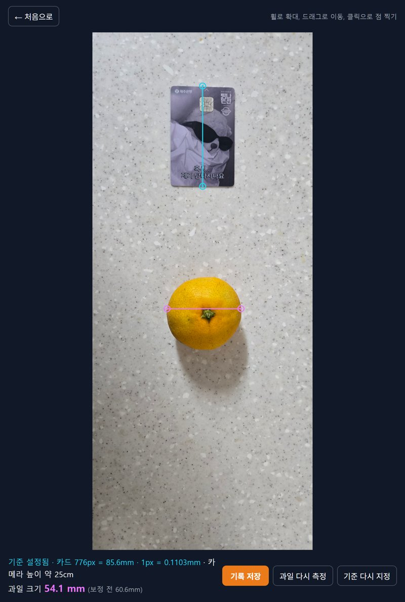
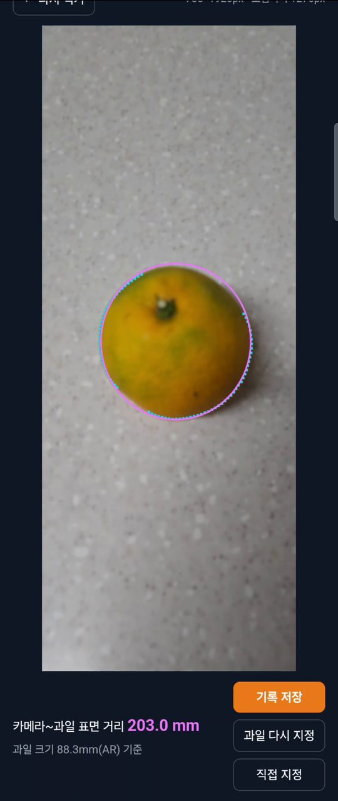

# fruit-measure

과일 크기와 측정 거리를 재는 웹앱입니다. 바이브 코딩(PRD → Todo → 테스트)으로 두 번에 걸쳐 만들었습니다.

| 버전 | 한 줄 소개 | 바로 사용하기 | 문서 |
|---|---|---|---|
| **v1 (1차)** | 신용카드와 함께 찍은 사진으로 과일 크기를 재는 PC 웹앱 | https://lgosoup.github.io/fruit-measure/ | [PRD](PRD.md) · [Todo](todo.md) |
| **v2 (2차)** | 폰 AR로 크기를 재고, 가까이서 찍은 사진으로 거리까지 재는 폰 웹앱 | https://lgosoup.github.io/fruit-measure/v2/ | [PRD](v2/PRD.md) · [Todo](v2/todo.md) · [README](v2/README.md) |

  
  
  

왼쪽부터 v1 크기 측정, v2 AR 과일 인식, v2 사진으로 거리 계산.

---

## 1. 제작한 것 소개

### 왜 만들었나

만감류(한라봉·천혜향 등)의 당도를 근적외선으로 비파괴 추정하는 연구에서는 과일 크기를 보정 변수로 함께 기록해야 합니다. 캘리퍼스로 하나씩 재고 손으로 적는 대신, 사진 한 장을 불러와 몇 번 클릭하는 것만으로 크기를 재고 기록합니다.

v1을 완성하고 보니 매번 카드를 놓아야 했고, 근적외선 측정에 필요한 **센서와 과일 사이 거리**는 여전히 자로 재야 했습니다. 그래서 개발을 이어 폰 하나로 크기와 거리를 함께 재는 v2를 만들었습니다.

### 버전별 기능

| 기능 | v1 (PC) | v2 (폰) |
|---|---|---|
| 크기 기준 | 신용카드(85.6mm) | AR(ARCore)로 잰 실제 크기 |
| 과일 지정 | 사진에서 양 끝 클릭 | 조준점으로 「과일 인식」(윤곽 자동 인식) 또는 양 끝 지정 |
| 둥근 과일 보정 | 사진 촬영 정보로 카메라 높이를 구해 보정 | 구의 윤곽(원뿔)과 AR 카메라 높이로 바로 계산 |
| 거리 측정 | — | 10cm 근처에서 찍은 사진으로 카메라~과일 표면 거리 |
| 기록 | 측정 번호, 크기, 시각 저장·삭제 | v1과 같은 목록에 거리까지 저장 |

v2의 사용 방법과 측정 원리는 [v2/README.md](v2/README.md)에 있습니다. 아래는 v1 설명입니다.

### v1 사용 방법

1. 과일과 신용카드를 테이블 위에 나란히 놓고 위에서 사진을 찍습니다. 카메라로 찍은 원본 사진 파일을 쓰세요.
2. 「사진 불러오기」로 사진을 선택합니다.
3. 신용카드의 긴 변 양 끝을 클릭합니다. 카드 길이(85.6mm)가 기준이 됩니다.
4. 과일의 양 끝을 클릭하면 과일 크기(mm)가 표시됩니다.
5. 「기록 저장」을 누르면 측정 번호, 크기, 측정 시각이 기록됩니다. 「기록 보기」에서 목록을 보고 잘못 잰 기록은 삭제할 수 있습니다.

사진은 마우스 휠로 확대·축소하고, 드래그로 이동합니다. 확대하면 모서리를 더 정확하게 찍을 수 있습니다. 클릭 위치가 조금 어긋나면 「과일 다시 측정」이나 「기준 다시 지정」으로 다시 찍습니다.

[`카트+귤.jpg`](카트+귤.jpg)는 실제 폰으로 찍은 테스트 사진입니다. 앱에서 불러와 카드의 긴 변과 귤의 가로 지름을 클릭해 볼 수 있습니다.

### v1 측정 원리

- 카드의 실제 길이(85.6mm)와 사진에서 카드가 차지한 픽셀 수로 사진 1픽셀이 몇 mm인지 구합니다.
- 둥근 과일은 가장 넓은 부분이 테이블에서 떠 있어 카메라에 가까운 만큼 실제보다 크게 찍힙니다. 사진에 들어 있는 촬영 정보(35mm 환산 초점거리)와 카드 크기로 카메라 높이를 구해 이를 보정합니다.
- 촬영 정보가 없는 사진(스크린샷, 메신저로 받은 사진 등)은 보정 없이 측정값만 보여줍니다.
- 점은 원본 사진의 픽셀 좌표로 저장하므로, 확대 배율이 달라도 같은 결과가 나옵니다.

### 알아둘 점

- 기록은 사용하는 기기의 브라우저에만 저장됩니다. 서버나 계정이 없고, 다른 기기나 브라우저에서는 보이지 않습니다. 브라우저의 사이트 데이터를 지우면 기록도 사라집니다.
- v1은 카메라가 테이블을 거의 수직으로 내려다보고, 카드와 과일이 가까이 있을수록 정확합니다. 심하게 비스듬히 찍은 사진은 오차가 커집니다.
- v1에서는 거리 측정, AR, 모바일 지원, 앱 안 카메라 촬영, 당도 추정, 윤곽 자동 인식을 만들지 않았습니다. 거리·AR·폰 촬영·윤곽 자동 인식은 v2에서 다룹니다.

### 기술

HTML, CSS, JavaScript만 사용했습니다(빌드나 외부 라이브러리 없음). 사진은 Canvas에 그리고, 기록은 `localStorage`에 저장합니다. GitHub Pages로 배포합니다. v2는 여기에 WebXR(크롬이 ARCore로 AR 실행)을 더했습니다.

직접 실행하려면 이 폴더에서 정적 서버를 띄우고 `index.html`을 엽니다. 예: `python -m http.server`

---

## 2. PRD와 Todo 리스트

| 문서 | v1 | v2 |
|---|---|---|
| PRD | [PRD.md](PRD.md) | [v2/PRD.md](v2/PRD.md) — v1 항목을 "1차 #3과 같음"처럼 참조하고 바뀐 것만 씀 |
| Todo | [todo.md](todo.md) — 6단계, 할 일 51개 | [v2/todo.md](v2/todo.md) — 7단계, v1 항목을 "1차 5-7"처럼 참조 |

- PRD를 먼저 쓰고, 「만들지 않는 것」으로 범위를 정한 뒤 Todo로 나눴습니다.
- Todo의 할 일마다 번호(`단계-순번`), 우선순위(P1~P3), 근거가 되는 PRD 항목, 짝이 되는 테스트를 붙였습니다.
- 단계마다 테스트를 통과하면 commit·push했고, 커밋 메시지에 Todo 번호를 넣었습니다. 진행하며 찾은 버그는 「버그 수정」 항목으로 Todo에 추가했습니다.
- v2 Todo에는 v1에서 아쉬웠던 점을 반영해 단계마다 [회귀 테스트], 폰에서만 확인할 수 있는 [폰] 항목을 처음부터 넣었습니다.

### 단계별 커밋

| 단계 | v1 | v2 |
|---|---|---|
| 기획 | `990a734` PRD 작성 · `bf16d2f` Todo 작성 | `2bae884` 2차 PRD·Todo |
| 1 | `ad9b3f0` 첫 화면 | `4b9d290` 첫 화면, AR 지원 확인 |
| 2 | `f1797bb` `2143e76` 사진 불러오기·확대·이동 | `ccf8786` AR 화면과 촬영 |
| 3 | `981f3a0` 신용카드 기준 지정 | `206c0a9` AR 크기 측정 |
| 4 | `5910b55` `34b4282` 과일 크기, 둥근 과일 보정 | `6ee4c3d` 사진으로 거리 계산 |
| 5 | `529dfce` `9a3b0a7` 기록 저장·삭제 | `06975f5` 기록 저장(v1과 공유) |
| 6 | `f8ad7fc` `7e564e4` 완성 기준 점검, 엉뚱한 사용 버그 수정 | `ac0c284` 폰 확인 |
| 7 | — | `056e580` 과일 윤곽 자동 인식 |

---

## 3. 방법론의 장단점

| 방법론 | 장점 | 단점 |
|---|---|---|
| **PRD** | 「만들지 않는 것」이 AI가 범위를 넓히지 못하게 막았고, 이어서 개발할 때는 그대로 다음 후보 목록이 됐다. 「열린 질문」에 적은 문제(둥근 과일은 크게 찍힘)를 구현 전에 결정하면서, AI가 낸 3가지 안보다 사람이 낸 방법(카드로 카메라 높이 계산)을 채택했다 | 방향을 바꿨을 때(폰 → PC) 문서 일부에 옛 내용이 남아, AI가 그걸 기준 삼아 폰 기능을 계속 만들었다 |
| **Todo** | 작게 쪼개 문제가 생기면 어느 단계인지 바로 보였다. "10cm 촬영이 안 되면 안드로이드 앱으로 전환"처럼 결정 지점을 미리 넣어 두었다 | 계획에 없던 기능(기록 삭제)을 끼우자 이미 끝난 단계가 깨졌다(번호 중복). 마지막 단계가 「완성 점검」이라 완성 뒤 기능을 더하니 순서가 꼬였다 |
| **테스트** | AI가 정답을 아는 테스트 데이터를 직접 만들었다(카드 사진, 계산으로 그린 과일, 가짜 AR 세션). PC에서만 검증한 v2가 폰에서 처음 실행에 바로 동작했다. 화면을 직접 보는 검토로 숫자로는 못 찾는 버그(주황 과일 위 주황 선 등)를 찾았다 | 실제 카메라·조명·손가락 감도는 결국 사람이 폰으로 확인해야 했다. 일부러 괴롭히는 테스트를 늦게 해 버그 3건이 마지막에 나왔다 |
| **도구 선택·AI 활용** | AI가 측정 방식별 원리·난이도를 빠르게 비교해 줘서 판단에 도움이 됐다 | "안드로이드 앱으로"라는 말을 AI가 그대로 따랐고, "웹앱은 안 되냐"고 되묻고서야 더 단순한 방법(WebXR)으로 바꿨다. AI의 "다 했다"는 보고를 원문과 대조하지 않아 Todo 우선순위가 처음부터 빠져 있었다 |

## 4. 개선이 필요한 점

| 부족한 점 | 개선 방향 |
|---|---|
| 정확도를 숫자로 비교하지 못했다(v2) | 캘리퍼스·자로 잰 값과 여러 과일로 비교 |
| AR 화면 위쪽 버튼이 폰 상태 표시줄에 가린다 | 화면 안전 영역을 반영해 위치 조정 |
| 완성 뒤 기능을 더하면 Todo 순서가 꼬인다 | 추가 기능은 자기 점검 단계를 가진 새 묶음으로 만든다 |
| 실제 근적외선 센서와 아직 연결하지 않았다 | 측정한 크기·거리를 센서 기록과 함께 저장 |

## 5. 결론

AI가 빠르게 만들게 하려면 사람은 **무엇을 만들지(PRD), 무엇을 안 만들지(제외), 무엇이 완성인지(테스트)**를 정해야 했습니다. 이 세 가지로 v1을 완성했고, 그 위에 이어서 v2를 개발할 수 있었습니다. 결정적인 아이디어(카드로 높이 계산, 과일은 구)는 사람이 냈고, 그걸 빠르게 구현하고 검증한 것은 AI였습니다.
