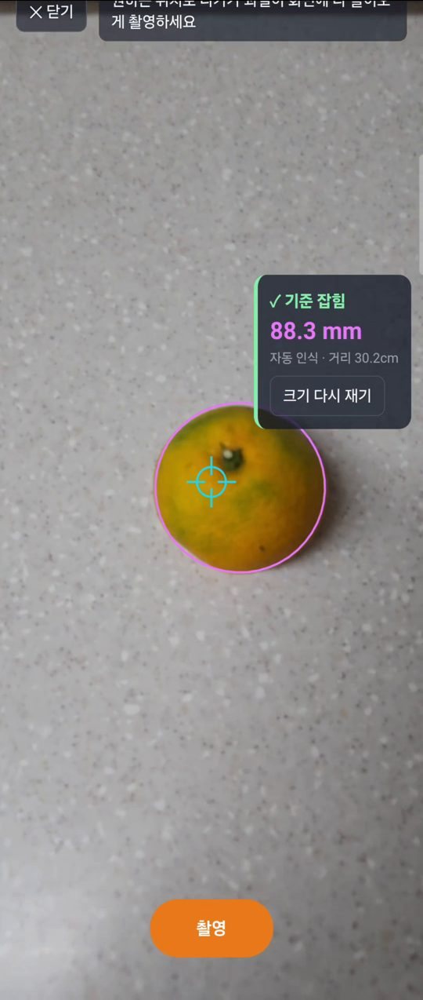

# fruit-measure

폰 AR로 과일 크기를 재서 기준을 잡고, 가까이서 찍은 사진으로 카메라와 과일 표면 사이 거리를 계산하는 웹앱입니다. 갤럭시 Z 플립6의 크롬용입니다. 바이브 코딩(PRD → Todo → 테스트)으로 만들었습니다.

**바로 사용하기(폰 크롬): https://lgosoup.github.io/fruit-measure/**

  
  
  

왼쪽부터 AR 과일 인식, 사진으로 거리 계산, 처음 만든 신용카드 기준 크기 측정(1~6단계).

---

## 1. 제작한 것 소개

### 왜 만들었나

만감류(한라봉·천혜향 등)의 당도를 근적외선으로 비파괴 추정하는 연구에서는 과일 크기와 **센서와 과일 사이 거리**를 보정 변수로 함께 기록해야 합니다. 신호가 희석되지 않도록 약 10cm 가까이에서 측정합니다. 캘리퍼스와 자로 하나씩 재고 손으로 적는 대신, 폰 하나로 크기와 거리를 재고 기록합니다.

### 사진과 기준

사진 속 과일을 재려면 실제 크기를 알려 줄 기준이 필요합니다.

- 처음(1~6단계)에는 과일 옆에 놓은 **신용카드(85.6mm)** 를 기준으로, 찍어 둔 사진을 PC에서 불러와 과일 크기를 쟀습니다.
- 매번 카드를 놓아야 했고, 근적외선 측정에 필요한 거리는 여전히 자로 재야 했습니다. 그래서 7단계부터 기준을 **AR로 잰 과일 크기**로 바꿨습니다. 과일 크기를 알면 가까이서 찍은 사진 속 크기만으로 거리를 역산할 수 있습니다.

### 사용 방법

1. 과일을 테이블 위에 놓고 「측정 시작」을 누릅니다. 카메라 권한을 허용합니다.
2. 폰을 천천히 움직여 테이블을 비추면 화면 가운데 조준점이 청록색으로 바뀝니다.
3. 30cm 이상 떨어져 과일을 내려다보며, 조준점을 과일에 맞추고 「과일 인식」을 누릅니다. 과일 둘레에 선이 그려지고 화면 옆에 「✓ 기준 잡힘」과 과일 크기가 뜹니다.
4. 인식이 안 되면 조준점을 과일 한쪽 가장자리에 맞추고 「점 찍기」, 반대쪽 가장자리도 「점 찍기」를 눌러 직접 잴 수 있습니다.
5. 원하는 위치(약 10cm)로 다가가 과일이 화면에 다 들어오게 「촬영」합니다.
6. 찍은 사진에서 과일 윤곽을 자동으로 찾아 카메라~과일 표면 거리가 바로 나옵니다. 둘레선이 과일과 다르면 과일을 터치해 다시 찾거나, 「직접 지정」을 눌러 과일 양 끝을 터치합니다. 두 손가락으로 확대·이동할 수 있습니다.
7. 「기록 저장」을 누르면 다음 과일을 잴 수 있도록 AR 화면으로 돌아갑니다. 「기록 보기」에서 목록을 보고 삭제할 수 있습니다.

### 측정 원리

- **둥근 과일 보정:** 과일의 가장 넓은 부분은 테이블에서 반지름만큼 떠 있어 카메라에 가까운 만큼 크게 찍힙니다. 카메라 높이를 알면 이를 계산으로 보정합니다. 처음에는 카드 크기와 사진의 촬영 정보(35mm 환산 초점거리)로 카메라 높이를 구했고, 지금은 AR이 알려준 높이를 씁니다.
- **크기(AR):** 조준점으로 과일 가장자리를 겨눈 시선이 테이블 면에 닿는 두 위치를 AR로 얻고, 위 보정식으로 크기를 구합니다.
- **거리(사진):** 과일은 거의 구라서, 양 끝을 겨눈 두 시선은 구에 접합니다. 두 시선 사이 각도의 절반을 α라 하면 `중심까지 거리 = 반지름 / sin α`이고, 여기서 반지름을 빼면 표면까지 거리입니다. 시선 방향은 AR 카메라가 알려준 초점거리와 중심으로 계산합니다. 과일이 사진 가운데에 있지 않아도 성립합니다.
- 근거리에서 흔히 쓰는 단순 비례식(초점거리 × 지름 ÷ 사진 속 지름)은 10cm에서 약 5% 짧게 나와 쓰지 않았습니다.
- **윤곽 자동 인식:** 가리킨 지점에서 120개 방향으로 선을 뻗어 과일 색과 달라지는 첫 지점(경계점)을 찾습니다. 과일은 구라서 윤곽을 지나는 시선은 모두 「카메라→과일 중심」 축과 같은 각도를 이룹니다(원뿔). 경계점들을 이 원뿔에 맞추면서 맞지 않는 점은 버리므로, 윤곽 일부가 끊기거나 그림자·반사광·꼭지에서 멈춘 점이 있어도 둥근 윤곽을 찾습니다.
- 자동 인식한 원뿔은 각도만으로 거리가 나오고, AR에서는 원뿔 방향·각도와 카메라 높이로 과일 반지름이 바로 나옵니다(보정식이 필요 없음).
- AR 화면과 촬영 사진은 같은 카메라 이미지라 카메라 값이 그대로 맞습니다.

### 알아둘 점

- ARCore를 지원하는 안드로이드 크롬에서만 동작합니다. PC에서는 첫 화면에 안내만 나옵니다.
- 기록은 사용하는 기기의 브라우저에만 저장됩니다. 서버나 계정이 없고, 브라우저의 사이트 데이터를 지우면 기록도 사라집니다. 카드 기준으로 잰 기록은 거리 칸이 「–」입니다.
- 너무 가까이 다가가 AR이 위치를 잃으면 촬영할 수 없다는 안내가 뜹니다. 조금 떨어져 다시 촬영하세요.

### 기술

HTML, CSS, JavaScript와 WebXR(크롬이 ARCore로 AR 실행)을 사용했습니다. 빌드나 외부 라이브러리는 없고, GitHub Pages로 배포합니다.

- `measure.js`: 계산식(크기 보정, 거리 계산, 원뿔 맞추기, 좌표 변환)
- `detect.js`: 과일 윤곽 자동 인식
- `app.js`: 화면, AR, 촬영, 터치, 기록
- 계산식 테스트: `node test/measure.test.js`
- 윤곽 인식 테스트(계산으로 그린 과일 사진): `node test/detect.test.js`

---

## 2. PRD와 Todo 리스트

- [PRD.md](PRD.md): 요구사항. 「만들지 않는 것」으로 범위를 정했습니다.
- [todo.md](todo.md): 13단계. 1~6단계는 신용카드 기준 PC 측정, 7~13단계는 AR 기준 폰 측정입니다.

- PRD를 먼저 쓰고, 「만들지 않는 것」으로 범위를 정한 뒤 Todo로 나눴습니다.
- Todo의 할 일마다 번호(`단계-순번`), 우선순위(P1~P3), 근거가 되는 PRD 항목, 짝이 되는 테스트를 붙였습니다.
- 단계마다 테스트를 통과하면 commit·push했고, 커밋 메시지에 Todo 번호를 넣었습니다. 진행하며 찾은 버그는 「버그 수정」 항목으로 Todo에 추가했습니다.
- 7단계부터는 앞 단계에서 아쉬웠던 점을 반영해 단계마다 [회귀 테스트], 폰에서만 확인할 수 있는 [폰] 항목을 처음부터 넣었습니다. AR·카메라는 PC에서 실행할 수 없어서, PC에서는 WebXR을 흉내 낸 가짜 세션으로 흐름을 확인했습니다.

### 단계별 커밋

7~13단계 커밋 메시지는 「2차 todo 1-1」처럼 단계 번호에서 6을 뺀 번호로 적혀 있습니다.

| 단계 | 내용 | 커밋 |
|---|---|---|
| 기획 | PRD·Todo | `990a734` `bf16d2f` |
| 1 | 첫 화면 | `ad9b3f0` |
| 2 | 사진 불러오기·확대·이동 | `f1797bb` `2143e76` |
| 3 | 신용카드 기준 지정 | `981f3a0` |
| 4 | 과일 크기, 둥근 과일 보정 | `5910b55` `34b4282` |
| 5 | 기록 저장·삭제 | `529dfce` `9a3b0a7` |
| 6 | 완성 기준 점검, 엉뚱한 사용 버그 수정 | `f8ad7fc` `7e564e4` |
| 기획 | AR 기준으로 PRD·Todo 확장 | `2bae884` |
| 7 | AR 첫 화면, AR 지원 확인 | `4b9d290` |
| 8 | AR 화면과 촬영 | `ccf8786` |
| 9 | AR 크기 측정 | `206c0a9` |
| 10 | 사진으로 거리 계산 | `6ee4c3d` |
| 11 | 기록 저장(카드 기준 기록과 공유) | `06975f5` |
| 12 | 완성 기준 점검(폰 확인) | `ac0c284` |
| 13 | 과일 윤곽 자동 인식 | `056e580` |

---

## 3. 방법론의 장단점

| 방법론 | 장점 | 단점 |
|---|---|---|
| **PRD** | 「만들지 않는 것」이 AI가 범위를 넓히지 못하게 막았고, 이어서 개발할 때는 그대로 다음 후보 목록이 됐다. 「열린 질문」에 적은 문제(둥근 과일은 크게 찍힘)를 구현 전에 결정하면서, AI가 낸 3가지 안보다 사람이 낸 방법(카드로 카메라 높이 계산)을 채택했다 | 방향을 바꿨을 때(폰 → PC) 문서 일부에 옛 내용이 남아, AI가 그걸 기준 삼아 폰 기능을 계속 만들었다 |
| **Todo** | 작게 쪼개 문제가 생기면 어느 단계인지 바로 보였다. "10cm 촬영이 안 되면 안드로이드 앱으로 전환"처럼 결정 지점을 미리 넣어 두었다 | 계획에 없던 기능(기록 삭제)을 끼우자 이미 끝난 단계가 깨졌다(번호 중복). 마지막 단계가 「완성 점검」이라 완성 뒤 기능을 더하니 순서가 꼬였다 |
| **테스트** | AI가 정답을 아는 테스트 데이터를 직접 만들었다(카드 사진, 계산으로 그린 과일, 가짜 AR 세션). PC에서만 검증한 AR 기능이 폰에서 처음 실행에 바로 동작했다. 화면을 직접 보는 검토로 숫자로는 못 찾는 버그(주황 과일 위 주황 선 등)를 찾았다 | 실제 카메라·조명·손가락 감도는 결국 사람이 폰으로 확인해야 했다. 일부러 괴롭히는 테스트를 늦게 해 버그 3건이 마지막에 나왔다 |
| **도구 선택·AI 활용** | AI가 측정 방식별 원리·난이도를 빠르게 비교해 줘서 판단에 도움이 됐다 | "안드로이드 앱으로"라는 말을 AI가 그대로 따랐고, "웹앱은 안 되냐"고 되묻고서야 더 단순한 방법(WebXR)으로 바꿨다. AI의 "다 했다"는 보고를 원문과 대조하지 않아 Todo 우선순위가 처음부터 빠져 있었다 |

## 4. 개선이 필요한 점

| 부족한 점 | 개선 방향 |
|---|---|
| AR 크기·사진 거리의 정확도를 숫자로 비교하지 못했다 | 캘리퍼스·자로 잰 값과 여러 과일로 비교 |
| AR 화면 위쪽 버튼이 폰 상태 표시줄에 가린다 | 화면 안전 영역을 반영해 위치 조정 |
| 완성 뒤 기능을 더하면 Todo 순서가 꼬인다 | 추가 기능은 자기 점검 단계를 가진 새 묶음으로 만든다 |
| 실제 근적외선 센서와 아직 연결하지 않았다 | 측정한 크기·거리를 센서 기록과 함께 저장 |

## 5. 결론

AI가 빠르게 만들게 하려면 사람은 **무엇을 만들지(PRD), 무엇을 안 만들지(제외), 무엇이 완성인지(테스트)**를 정해야 했습니다. 이 세 가지로 카드 기준 측정을 완성했고, 그 위에 이어서 AR 기준과 거리 측정을 개발할 수 있었습니다. 결정적인 아이디어(카드로 높이 계산, 과일은 구)는 사람이 냈고, 그걸 빠르게 구현하고 검증한 것은 AI였습니다.
